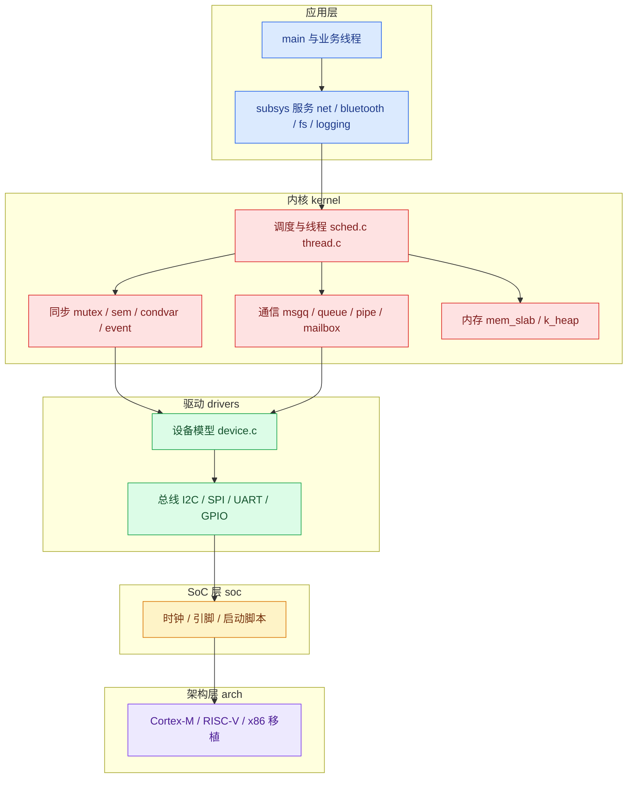
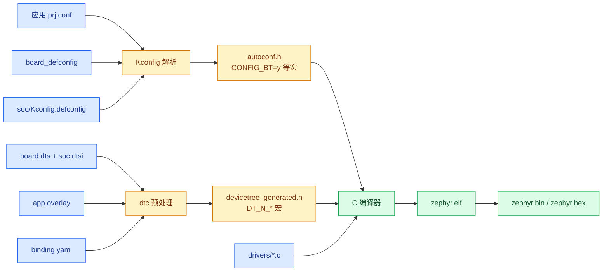

# Zephyr 源码详解 00：总览与架构

> 涉及文件：
> - `VERSION`（版本号，当前 `4.5.0-rc1`）
> - `README.rst`（项目定位与资源索引）
> - `CMakeLists.txt`（构建入口，注意它不是应用顶层 CMakeLists）
> - `Kconfig.zephyr`（Kconfig 根，按 board → soc → arch → kernel 顺序 source）
> - `west.yml`（manifest，声明全部 modules）
> - `kernel/`、`arch/`、`soc/`、`boards/`、`drivers/`、`subsys/`、`include/zephyr/`
>
> 本篇是全套 8 篇的总入口；逐模块细节见 `01`~`07`，源码级条目见
> `../../../05-学习笔记与知识库/Knowledge-Base/zephyr/` 下的 9 条 KB。

---

## 1. 这个仓库有多大

先给规模，后面的"为什么这样设计"才有参照系。统计口径为当前 checkout
（`VERSION` 为 `4.5.0-rc1`）：

| 维度 | 数量 | 说明 |
|---|---|---|
| 文件总数 | 68,748 | `find . -type f` |
| C 源文件 | 9,742 | 含 tests/samples |
| 头文件 | 5,692 | `include/zephyr` 下 2,256 |
| `Kconfig*` 文件 | 7,895 | 每个驱动目录一份 |
| `CMakeLists.txt` | 3,798 | 每个目录一份 |
| `.dts` / `.dtsi` | 6,144 | 板级 + SoC + 虚拟平台 |
| devicetree binding (`*.yaml`) | 4,400 | `dts/bindings/` |
| `arch/` 架构族 | 14 个目录 | arm/arm64/riscv/x86/arc/xtensa/... |
| `soc/` 厂商/系列 | 61 个目录 | st/nxp/nordic/espressif/... |
| `boards/` vendor | 187 个 | `find boards -maxdepth 1 -type d` |
| `boards/` 板级目录 | 1,313 个 | 二级目录 |
| `drivers/` 类别 | 102 个 | adc/can/display/sensor/... |
| `subsys/` 子系统 | 54 个 | net/bluetooth/fs/logging/pm/... |
| `kernel/*.c` | 43 个 | 内核本体，不含 arch 移植层 |

**结论先行**：Zephyr 不是一个"内核 + 少量驱动"的 RTOS，而是一个
"内核 + 驱动框架 + 协议栈 + 构建系统 + 板级数据库"的完整发行版。
读它必须带着"分层 + 配置驱动"两个前提，否则会在 1500 个 board 目录里迷路。

---

## 2. 五层架构



### 2.1 各层的职责与"可替换点"

| 层 | 目录 | 对上提供 | 对下依赖 | 典型替换点 |
|---|---|---|---|---|
| 应用 | `samples/`、用户工程 | 业务逻辑 | 全部 | 无（用户代码） |
| 子系统 | `subsys/` | socket、GATT、文件系统 | 内核 + 驱动 | `CONFIG_NET_*` 等 |
| 内核 | `kernel/` | 线程/同步/通信/内存 | `arch/` 的 5 个原语 | 调度器 `CONFIG_SCHED_*` |
| 驱动 | `drivers/` | 统一 API（`*_driver_api`） | 设备模型 + 总线 | 同一 API 多实现 |
| SoC | `soc/<vendor>/<series>` | 时钟、引脚、启动 | `arch/` | 换 SoC 只换这层 |
| 架构 | `arch/<isa>` | 上下文切换、中断入口 | CPU 硬件 | 14 个 ISA 各一份 |

关键点：**内核只依赖 `arch/` 暴露的极窄接口**，主要是
`arch_switch()`、`arch_irq_lock()`、`arch_new_thread()`、
`arch_kernel_init()`、`z_arm_exc_exit()` 这类函数（不同 arch 名字略有差异）。
`kernel/` 里没有一行 `#include <cmsis_core.h>`，这是它能同时跑在
Cortex-M、RISC-V、x86、POSIX 上的根本原因。

### 2.2 一个反直觉的事实：`kernel/` 不是最小可运行集

`kernel/` 下 43 个 `.c` 是按功能拆的，不是按编译单元拆的：

```
kernel/sched.c        调度决策（选下一个线程、就绪队列操作）
kernel/thread.c       线程生命周期（创建/挂起/abort/join）
kernel/timeout.c      超时队列（tick 驱动）
kernel/timeslicing.c  时间片
kernel/sem.c          k_sem
kernel/mutex.c        k_mutex（含优先级继承）
kernel/msg_q.c        k_msgq
kernel/queue.c        k_queue（k_fifo/k_lifo 的底座）
kernel/pipe.c         k_pipe
kernel/mailbox.c      k_mbox
kernel/mem_slab.c     k_mem_slab
kernel/kheap.c        k_heap（k_malloc 的底层）
kernel/mempool.c      k_malloc/k_free 兼容层
kernel/device.c       struct device 的运行时服务
kernel/init.c         z_cstart 与 SYS_INIT 执行器
```

真正"必须有"的是 `init.c + sched.c + thread.c + timeout.c`；
其余都能被 Kconfig 裁掉。一个 `CONFIG_MULTITHREADING=n` 的
最小镜像可以只有 `kernel/nothread.c` + `main_weak.c`。

---

## 3. 双配置体系：Kconfig + devicetree

这是 Zephyr 与 FreeRTOS 最大的工程差异。两者解决的是不同问题：

| 问题 | 由谁回答 | 产物 | 典型例子 |
|---|---|---|---|
| 编不编这个功能？ | Kconfig | `autoconf.h` 里的 `CONFIG_*` | `CONFIG_BT=y` |
| 这个功能多大？ | Kconfig | `CONFIG_BT_BUF_ACL_RX_SIZE=251` | 缓冲区尺寸 |
| 板上有几颗 I2C？ | devicetree | `DT_N_S_soc_S_i2c_40003000` | SoC dtsi |
| 某颗传感器接在哪？ | devicetree | `DT_NODELABEL(lsm6dsl)` | board dts |
| 驱动匹配哪类节点？ | devicetree | `DT_DRV_COMPAT` + binding yaml | `bosch,lsm6dsl` |

### 3.1 两条配置流如何汇合到编译



`Kconfig.zephyr` 的 source 顺序就是优先级顺序（第 1~30 行）：

```kconfig
source "Kconfig.constants"

osource "$(APPLICATION_SOURCE_DIR)/VERSION"

# This should be sourced early since the autogen Kconfig.dts options
# and macros may get used by shields/boards/SoC defconfig or modules.
source "dts/Kconfig"

# Include Kconfig.defconfig files first so that they can override defaults and
# other symbol/choice properties by adding extra symbol/choice definitions.
# After merging all definitions for a symbol/choice, Kconfig picks the first
# property (e.g. the first default) with a satisfied condition.
#
# Shield defaults should have precedence over board defaults, which should
# have precedence over SoC defaults, so include them in that order.
```

注意 `osource`（optional source）：文件不存在不报错。这让
"厂商私有 Kconfig"可以放在仓库外。

### 3.2 为什么不能只用一个 Kconfig

设想 `boards/nrf52840dk`：它需要 `CONFIG_SOC_NRF52840`、`CONFIG_BOARD_NRF52840DK`，
还需要 `DT_NODELABEL(uart0)` 知道 UART 寄存器地址。前者是"功能开关"，
后者是"硬件拓扑"。把后者塞进 Kconfig 会导致每块板子生成上百个
`CONFIG_UART0_BASE=0x40002000` 之类的宏，无法跨板复用驱动。
devicetree 的 `compatible` 机制让驱动只写一次：

```c
#define DT_DRV_COMPAT nordic_nrf_uart
```

编译时 `DT_INST_FOREACH_STATUS_OKAY` 会把所有 `status = "okay"` 的
匹配节点展开成多份 `struct device`。

---

## 4. 启动链一眼看全

不展开（见 `01-启动流程与初始化.md`），只给主干：

```
复位向量 z_arm_reset
  → z_prep_c           (arch/arm/core/cortex_m/prep_c.c:198)
    → arch_bss_zero / arch_data_copy
    → z_arm_interrupt_init
    → z_cstart         (kernel/init.c:541)
      → INIT_LEVEL_EARLY
      → arch_kernel_init
      → PRE_KERNEL_1 / PRE_KERNEL_2
      → prepare_multithreading  (建 main 线程 + idle 线程)
      → switch_to_main_thread
        → bg_thread_main  (kernel/init.c:272)
          → POST_KERNEL
          → APPLICATION
          → main()
```

`z_cstart` 的 622 行文件里，真正做事的只有上面 8 个调用点，
其余全是 `#ifdef` 与 tracing。读 `init.c` 的正确姿势是"先看调用顺序，
再回头查每个 `#ifdef` 属于哪个 feature"。

---

## 5. 与 FreeRTOS / NuttX 的对比

| 维度 | Zephyr 4.5 | FreeRTOS 11.x | NuttX |
|---|---|---|---|
| 许可证 | Apache-2.0 | MIT | Apache-2.0 |
| 配置方式 | Kconfig + devicetree | `FreeRTOSConfig.h` 手写宏 | Kconfig + board defconfig |
| 调度 | 优先级抢占 + 时间片 + EDF + meta-IRQ | 优先级抢占 + 时间片 | 优先级抢占 + 时间片 + Sporadic |
| 优先级数量 | 默认 16 coop + 15 preempt + idle | `configMAX_PRIORITIES`，默认 5~32 | 可配，默认 255 |
| 就绪队列 | 红黑树 / 多队列 / 有序链表三选一 | 每优先级一条 `pxReadyTasksLists` | 每优先级链表 |
| 同步原语 | mutex(优先级继承)/sem/condvar/event/futex | mutex(继承)/sem/queue/event group | mutex/sem/condvar/mqueue |
| 内存 | `k_mem_slab` + `k_heap`(sys_heap) + 可选 MMU | heap_1~5 五种策略 | 多种 allocator + 可选 MMU |
| 用户态 | 有（`CONFIG_USERSPACE`，MPU/MMU 隔离） | 无（MPU 需第三方） | 部分（PROTECTED/KERNEL build） |
| SMP | 支持（`CONFIG_SMP`，每 CPU 就绪队列） | 官方 SMP 分支/亚马逊版 | 支持（较新版本） |
| 设备模型 | `struct device` + DT + 统一 API | 无（手写驱动） | 字符设备 `/dev` + VFS |
| 构建 | CMake + west + 多 stage 链接 | 手写 Makefile/CMake | configure + make |
| 代码规模 | 6.8 万文件 | ~200 文件 | ~1 万文件 |

**怎么选（工程视角）**：

- 只要一个 2 KB RAM 的任务调度器 → FreeRTOS 更省心，`FreeRTOSConfig.h`
  一页纸能看完。
- 要 POSIX、文件系统、shell、网络协议栈"全家桶" → NuttX 更接近 Unix。
- 要跨 14 种 ISA、要 DT 描述硬件、要 userspace 隔离、要长期维护的
  BSP 数据库 → Zephyr 的工程量在"配置系统"上，不在内核上。

一个量化对比：Zephyr 的 `kernel/` 约 1.6 万行（43 个 `.c`），
只比 FreeRTOS 的 `tasks.c + queue.c + list.c` 大 2~3 倍；
但 `boards/ + dts/ + soc/` 加起来超过 2 万个文件。**Zephyr 的复杂度
主要在外围，不在调度器。**

---

## 6. 仓库导览：先读哪、后读哪

| 顺序 | 目录/文件 | 读它的理由 | 建议投入 |
|---|---|---|---|
| 1 | `kernel/init.c` | 启动主干，串起所有 init level | 2 h |
| 2 | `kernel/sched.c` | 调度决策唯一真相 | 4 h |
| 3 | `kernel/thread.c` | 线程对象与生命周期 | 4 h |
| 4 | `kernel/mutex.c` | 优先级继承链，最烧脑 | 3 h |
| 5 | `kernel/msg_q.c` | 环形队列 + 直接 handoff | 2 h |
| 6 | `kernel/kheap.c` | 堆的阻塞分配语义 | 1 h |
| 7 | `kernel/device.c` + `include/zephyr/device.h` | 驱动模型 | 3 h |
| 8 | `arch/arm/core/cortex_m/` | 中断/上下文切换落地 | 4 h |
| 9 | `cmake/modules/*.cmake` | 构建三元组 | 2 h |

**不要**从 `drivers/` 或 `subsys/net/` 开始：它们是"消费者"，
不理解 `struct device` 与 `k_sem` 会被几百个 `#ifdef` 淹没。

---

## 7. 版本与分支信息

```makefile
VERSION_MAJOR = 4
VERSION_MINOR = 5
PATCHLEVEL = 0
VERSION_TWEAK = 0
EXTRAVERSION = rc1
```

`4.5.0-rc1` 意味着：

- API 已冻结，但 `-rc` 期间仍可能有 ABI/行为修正；
- `kernel/` 里能看到一些"为下一个 LTS 做准备"的重构痕迹，例如
  `kernel/sched.c` 把 `next_up()` 拆成 SMP/UP 两条路径、
  `kernel/priority_q.h` 把三种就绪队列做成编译期宏切换。
- 与 3.x LTS 相比，`k_heap` 的 `sys_heap` 后端、`k_mem_slab` 的
  `K_KERNEL_INIT_PRE` 初始化、`z_cstart` 的 `k_kernel_init_pre_entry`
  钩子都是新增点，读旧文档时要注意。

---

## 8. 读码路径小结

1. **先建立"配置 → 代码"的映射**：任意打开一个驱动，找
   `DT_DRV_COMPAT` 和 `DEVICE_DT_INST_DEFINE`，再回 `dts/bindings` 找
   同名 yaml。走通一次，后面 100 个驱动都一样。
2. **再建立"中断 → 调度"的映射**：`vector_table.S` 的 16 个系统异常
   → `_isr_wrapper` → `_sw_isr_table[irq]` → 用户 ISR →
   `z_arm_exc_exit` → `z_get_next_switch_handle`。
3. **最后读同步**：所有同步原语最终都落到
   `z_pend_curr()` / `z_unpend_first_thread()` / `z_reschedule()` 三个函数，
   把这三个看懂，`mutex/sem/msgq/pipe` 只是"摆弄 wait_q 的策略不同"。

> 下一篇：`01-启动流程与初始化.md`，从复位向量逐行走到 `main()`。
