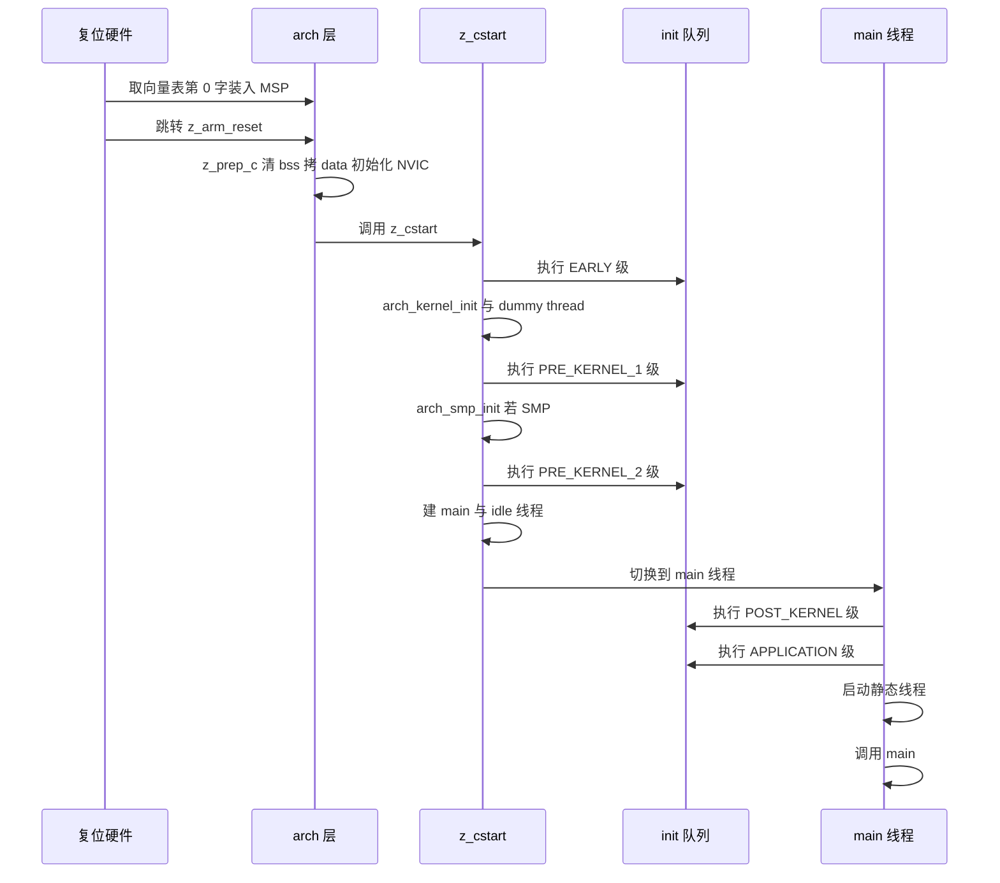
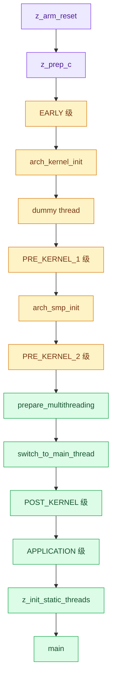
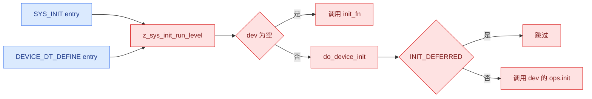

# Zephyr 源码详解 01：启动流程与初始化

> 涉及文件：
> - `arch/arm/core/cortex_m/reset.S`（复位向量）
> - `arch/arm/core/cortex_m/vector_table.S`（96 行）
> - `arch/arm/core/cortex_m/prep_c.c`（`z_prep_c`，223 行）
> - `kernel/init.c`（`z_cstart`、`bg_thread_main`，622 行）
> - `include/zephyr/init.h`（`SYS_INIT`，189 行）
> - `kernel/Kconfig.device`（初始化优先级）
> - KB：`../../../05-学习笔记与知识库/Knowledge-Base/zephyr/z_cstart.md`、`../../../05-学习笔记与知识库/Knowledge-Base/zephyr/sys_init.md`

---

## 1. 全景：从复位到 main 的 9 个阶段

| # | 阶段 | 执行位置 | 栈 | 能调内核 API | 代码 |
|---|---|---|---|---|---|
| 1 | 取复位向量 | 硬件 | MSP = 向量表[0] | 否 | `vector_table.S:40` |
| 2 | `z_arm_reset` | 汇编 | MSP → PSP | 否 | `reset.S` |
| 3 | `z_prep_c` | C | PSP | 否 | `prep_c.c:198` |
| 4 | `z_cstart` | C | 中断栈 | 部分 | `init.c:541` |
| 5 | `INIT_LEVEL_EARLY` | C | 中断栈 | 否 | `init.c:547` |
| 6 | `PRE_KERNEL_1/2` | C | 中断栈 | 否 | `init.c:574/578` |
| 7 | `prepare_multithreading` | C | 中断栈 | 是 | `init.c:444` |
| 8 | `switch_to_main_thread` | 汇编/C | main 栈 | 是 | `init.c:478` |
| 9 | `bg_thread_main` → `main()` | C | main 栈 | 是 | `init.c:272` |

**一句话**：`z_cstart` 之前是"搭 C 运行环境"，`z_cstart` 之后是
"按 level 排队跑初始化"，`bg_thread_main` 是 main 线程入口。

---

## 2. 阶段 1~3：复位与 C 环境

### 2.1 向量表的第一个字就是栈顶

`vector_table.S:33-45`：

```asm
SECTION_SUBSEC_FUNC(exc_vector_table,_vector_table_section,_vector_table)

    /*
     * setting the _very_ early boot on the main stack allows to use memset
     * on the interrupt stack when CONFIG_INIT_STACKS is enabled before
     * switching to the interrupt stack for the rest of the early boot
     */
    .word z_main_stack + CONFIG_MAIN_STACK_SIZE

    .word z_arm_reset
    .word z_arm_nmi

    .word z_arm_hard_fault
```

Cortex-M 复位时硬件从地址 0 取第一个字装入 MSP，从 0x04 取第二个字
装入 PC。所以第一项不是代码，是**初始栈顶**。
`CONFIG_MAIN_STACK_SIZE` 默认 1024 B（`kernel/Kconfig:143`）。

### 2.2 `z_prep_c` 的四件事

`prep_c.c:198-223`：

```c
FUNC_NORETURN void z_prep_c(void)
{
	soc_prep_hook();

	relocate_vector_table();
#if defined(CONFIG_CPU_HAS_FPU)
	z_arm_floating_point_init();
#endif
	arch_bss_zero();
	arch_data_copy();
#if defined(CONFIG_ARM_CUSTOM_INTERRUPT_CONTROLLER)
	/* Invoke SoC-specific interrupt controller initialization */
	z_soc_irq_init();
#else
	z_arm_interrupt_init();
#endif /* CONFIG_ARM_CUSTOM_INTERRUPT_CONTROLLER */
#if CONFIG_ARCH_CACHE
	arch_cache_init();
#endif

#ifdef CONFIG_NULL_POINTER_EXCEPTION_DETECTION_DWT
	z_arm_debug_enable_null_pointer_detection();
#endif
	z_cstart();
	CODE_UNREACHABLE;
}
```

| 行 | 调用 | 为什么必须在这里 |
|---|---|---|
| 200 | `soc_prep_hook()` | SoC 可能在 .bss 清零前就要配时钟 |
| 202 | `relocate_vector_table()` | 向量表从 Flash 搬到 RAM |
| 206 | `arch_bss_zero()` | C 全局变量必须为 0 |
| 207 | `arch_data_copy()` | `.data` 初值从 Flash 拷到 RAM |
| 212 | `z_arm_interrupt_init()` | 清 NVIC 使能/挂起位 |
| 221 | `z_cstart()` | 进入内核，不返回 |

`arch_bss_zero()` 之后 `_kernel` 才全 0——`init.c:438` 的注释
"all fields of `_kernel` are set to zero on entry" 依赖这一步。

---

## 3. `z_cstart`：内核初始化的总调度

### 3.1 主干（`kernel/init.c:541-578`）

```c
FUNC_NORETURN void z_cstart(void)
{
	/* gcov hook needed to get the coverage report.*/
	gcov_static_init();

	/* initialize early init calls */
	z_sys_init_run_level(INIT_LEVEL_EARLY);

	/* perform any architecture-specific initialization */
	arch_kernel_init();

	LOG_CORE_INIT();

#if defined(CONFIG_MULTITHREADING)
	z_dummy_thread_init(&_thread_dummy);
#endif /* CONFIG_MULTITHREADING */
	/* do any necessary initialization of static devices */
	z_device_state_init();

	soc_early_init_hook();

	board_early_init_hook();

	/* Run kernel pre-init hooks before PRE_KERNEL device init, so those
	 * drivers may use the kernel objects initialized here. Entries are
	 * present only for subsystems that are linked in (pay-per-use); the
	 * walk references only the section bounds.
	 */
	STRUCT_SECTION_FOREACH(k_kernel_init_pre_entry, entry) {
		entry->init_fn();
	}

	/* perform basic hardware initialization */
	z_sys_init_run_level(INIT_LEVEL_PRE_KERNEL_1);
#if defined(CONFIG_SMP)
	arch_smp_init();
#endif
	z_sys_init_run_level(INIT_LEVEL_PRE_KERNEL_2);
```

### 3.2 切换到 main 线程（`init.c:593-613`）

```c
#ifdef CONFIG_MULTITHREADING
	switch_to_main_thread(prepare_multithreading());
#else
#ifdef ARCH_SWITCH_TO_MAIN_NO_MULTITHREADING
	/* Custom ARCH-specific routine to switch to main()
	 * in the case of no multi-threading.
	 */
	ARCH_SWITCH_TO_MAIN_NO_MULTITHREADING(bg_thread_main,
		NULL, NULL, NULL);
#else
	bg_thread_main(NULL, NULL, NULL);

	/* LCOV_EXCL_START
	 * We've already dumped coverage data at this point.
	 */
	irq_lock();
	while (true) {
	}
	/* LCOV_EXCL_STOP */
#endif /* ARCH_SWITCH_TO_MAIN_NO_MULTITHREADING */
#endif /* CONFIG_MULTITHREADING */
```

中间 580~591 行是栈金丝雀随机数与 timing 初始化，不影响主干顺序。
### 3.3 关键顺序为什么不能换

| 顺序 | 动作 | 提前/推后的后果 |
|---|---|---|
| 1 | `EARLY` | EARLY 驱动可能给 `arch_kernel_init` 提供时钟 |
| 2 | `arch_kernel_init` | 建立中断栈、初始化 `_current_cpu` |
| 3 | `z_dummy_thread_init` | `_current` 必须非 NULL，否则 `k_spin_lock` 炸 |
| 4 | `z_device_state_init` | 给静态 device 做 `k_object_init` |
| 5 | `PRE_KERNEL_1` | 时钟/中断控制器驱动在这一级 |
| 6 | `arch_smp_init` | 从核要在 PRE_KERNEL_2 前能收 IPI |
| 7 | `PRE_KERNEL_2` | 依赖 PRE_KERNEL_1 的驱动 |
| 8 | `prepare_multithreading` | 建 main/idle，就绪队列第一次有内容 |
| 9 | `switch_to_main_thread` | 真正切栈，进入 main 线程上下文 |

`z_dummy_thread_init()`（`thread.c:1613`）把 `_current` 指向一个
`_THREAD_DUMMY` 状态的假线程，让 `k_spin_lock()` 这类
"必须有一个 current"的代码在调度器启动前也能跑。

### 3.4 中断栈的双重身份

`init.c:140-150`：

```c
/*
 * storage space for the interrupt stack
 *
 * Note: This area is used as the system stack during kernel initialization,
 * since the kernel hasn't yet set up its own stack areas. The dual purposing
 * of this area is safe since interrupts are disabled until the kernel context
 * switches to the init thread.
 */
K_KERNEL_STACK_ARRAY_DEFINE(z_interrupt_stacks,
				   CONFIG_MP_MAX_NUM_CPUS,
				   CONFIG_ISR_STACK_SIZE);
```

`CONFIG_ISR_STACK_SIZE` 默认 2048 B（`kernel/Kconfig:166`）。
`switch_to_main_thread` 之前，`z_cstart` 的全部调用链（含
PRE_KERNEL_1/2 的驱动 init）都跑在这 2 KB 上。这就是
`PRE_KERNEL_*` 不能阻塞、不能开中断的原因。

---

## 4. init level 机制

### 4.1 六个 level

`init.c:125-134`：

```c
enum init_level {
	INIT_LEVEL_EARLY = 0,
	INIT_LEVEL_PRE_KERNEL_1,
	INIT_LEVEL_PRE_KERNEL_2,
	INIT_LEVEL_POST_KERNEL,
	INIT_LEVEL_APPLICATION,
#ifdef CONFIG_SMP
	INIT_LEVEL_SMP,
#endif /* CONFIG_SMP */
};
```

`init.h:97-103` 给出同一套序号：

```c
/* Init level ordinals */
#define Z_INIT_ORD_EARLY	0
#define Z_INIT_ORD_PRE_KERNEL_1 1
#define Z_INIT_ORD_PRE_KERNEL_2 2
#define Z_INIT_ORD_POST_KERNEL	3
#define Z_INIT_ORD_APPLICATION	4
#define Z_INIT_ORD_SMP		5
```

两处必须一致：链接脚本用 `Z_INIT_ORD_*` 排序，`z_sys_init_run_level()`
用 `enum init_level` 做数组下标。

### 4.2 `SYS_INIT` 只生成一个结构体

`init.h:178-181`：

```c
#define SYS_INIT_NAMED(name, init_fn_, level, prio)                                       \
	static const Z_DECL_ALIGN(struct init_entry)                                      \
		Z_INIT_ENTRY_SECTION(level, prio, 0) __used __noasan                      \
		Z_INIT_ENTRY_NAME(name) = {.init_fn = (init_fn_), .dev = NULL}            \
```

`init_entry`（`init.h:74-85`）只有两个字段：`init_fn` 与 `dev`。
`SYS_INIT` 填 `init_fn`，`DEVICE_*_DEFINE` 填 `dev`。

`SYS_INIT` 的返回值被**忽略**（`init.h:148` 的 note）。
`return -EIO` 不会阻止启动，也不会打印；要错误处理必须自己
存全局变量。

### 4.3 section 名与排序

`init.h:119-121`：

```c
#define Z_INIT_ENTRY_SECTION(level, prio, sub_prio)                                                \
	__attribute__((__section__(                                                                \
		".z_init_" #level "_P_" STRINGIFY(prio) "_SUB_" STRINGIFY(sub_prio)"_")))
```

链接脚本（`common-rom-kernel-devices.ld:5-21`）：

```ld
		PLACE_SYMBOL_HERE(__init_start);
		CREATE_OBJ_LEVEL(init, EARLY)
		CREATE_OBJ_LEVEL(init, PRE_KERNEL_1)
		CREATE_OBJ_LEVEL(init, PRE_KERNEL_2)
		CREATE_OBJ_LEVEL(init, POST_KERNEL)
		CREATE_OBJ_LEVEL(init, APPLICATION)
		CREATE_OBJ_LEVEL(init, SMP)
		PLACE_SYMBOL_HERE(__init_end);
```

level 之间的先后由脚本写死；level 内部按 `P_<prio>` 做**字符串**排序。
**陷阱**：字符串排序下 `"100" < "20"`，prio=100 会排在 20 前面。
所以 prio 要用固定档位，不能跨位数混排。

### 4.4 默认优先级

`kernel/Kconfig.device:48-83`：

| 符号 | 默认 | 用途 |
|---|---|---|
| `KERNEL_INIT_PRIORITY_OBJECTS` | 30 | 内核对象 |
| `KERNEL_INIT_PRIORITY_LIBC` | 35 | libc |
| `KERNEL_INIT_PRIORITY_DEFAULT` | 40 | 默认 |
| `KERNEL_INIT_PRIORITY_DEVICE` | 50 | 不依赖其他设备的驱动 |
| `APPLICATION_INIT_PRIORITY` | 90 | 应用级驱动 |

### 4.5 执行器

`init.c:213-243`：

```c
static void z_sys_init_run_level(enum init_level level)
{
	static const struct init_entry *levels[] = {
		__init_EARLY_start,
		__init_PRE_KERNEL_1_start,
		__init_PRE_KERNEL_2_start,
		__init_POST_KERNEL_start,
		__init_APPLICATION_start,
#ifdef CONFIG_SMP
		__init_SMP_start,
#endif /* CONFIG_SMP */
		/* End marker */
		__init_end,
	};
	const struct init_entry *entry;

	for (entry = levels[level]; entry < levels[level+1]; entry++) {
		const struct device *dev = entry->dev;
		int result = 0;

		sys_trace_sys_init_enter(entry, level);
		if (dev != NULL) {
			if ((dev->flags & DEVICE_FLAG_INIT_DEFERRED) == 0U) {
				result = do_device_init(dev);
			}
		} else {
			result = entry->init_fn();
		}
		sys_trace_sys_init_exit(entry, level, result);
	}
}
```

两点：SYS_INIT 与设备 init **共用一条队列**（`dev != NULL` 走
`do_device_init()`）；`DEVICE_FLAG_INIT_DEFERRED` 的设备在启动阶段
被跳过。复杂度 O(n)。

---

## 5. 从单线程到多线程

### 5.1 `prepare_multithreading`

`init.c:443-475`：

```c
__boot_func
static char *prepare_multithreading(void)
{
	char *stack_ptr;

	/* _kernel.ready_q is all zeroes */
	z_sched_init();

#ifndef CONFIG_SMP
	/*
	 * prime the cache with the main thread since:
	 *
	 * - the cache can never be NULL
	 * - the main thread will be the one to run first
	 * - no other thread is initialized yet and thus their priority fields
	 *   contain garbage, which would prevent the cache loading algorithm
	 * to work as intended
	 */
	_kernel.ready_q.cache = &z_main_thread;
#endif /* CONFIG_SMP */
	stack_ptr = z_setup_new_thread(&z_main_thread, z_main_stack,
				       K_THREAD_STACK_SIZEOF(z_main_stack),
				       bg_thread_main,
				       NULL, NULL, NULL,
				       CONFIG_MAIN_THREAD_PRIORITY,
				       K_ESSENTIAL, "main");
	z_mark_thread_as_not_sleeping(&z_main_thread);
	z_ready_thread(&z_main_thread);

	z_init_cpu(0);

	return stack_ptr;
}
```

四步：初始化调度器；单核下把 `ready_q.cache` 直接指向 main；
建 main 线程（优先级默认 0）；`z_init_cpu(0)` 建 idle 线程。
`K_ESSENTIAL` 表示不能被 abort；`bg_thread_main` 在 `main()` 返回后
调用 `z_thread_essential_clear()` 解除（`init.c:352`）。

### 5.2 最后一次"手工"切换

`init.c:477-492`：

```c
__boot_func
static FUNC_NORETURN void switch_to_main_thread(char *stack_ptr)
{
#ifdef CONFIG_ARCH_HAS_CUSTOM_SWAP_TO_MAIN
	arch_switch_to_main_thread(&z_main_thread, stack_ptr, bg_thread_main);
#else
	ARG_UNUSED(stack_ptr);
	/*
	 * Context switch to main task (entry function is _main()): the
	 * current fake thread is not on a wait queue or ready queue, so it
	 * will never be rescheduled in.
	 */
	z_swap_unlocked();
#endif /* CONFIG_ARCH_HAS_CUSTOM_SWAP_TO_MAIN */
	CODE_UNREACHABLE; /* LCOV_EXCL_LINE */
}
```

这是唯一一次"没有前任线程"的切换：当前是 `_thread_dummy`（不在任何
队列），目标是 `z_main_thread`（已在就绪队列头）。

### 5.3 `bg_thread_main`

`init.c:286-318`：

```c
	z_sys_post_kernel = true;

#if CONFIG_IRQ_OFFLOAD
	arch_irq_offload_init();
#endif

	/* Run kernel post-init hooks before POST_KERNEL device init, so that
	 * drivers initialized there may use them (e.g. submit to the system
	 * work queue). Entries are present only for subsystems that are linked
	 * in (pay-per-use); the walk references only the section bounds.
	 */
	STRUCT_SECTION_FOREACH(k_kernel_init_post_entry, entry) {
		entry->init_fn();
	}

	z_sys_init_run_level(INIT_LEVEL_POST_KERNEL);

	soc_late_init_hook();

	board_late_init_hook();

#if defined(CONFIG_STACK_POINTER_RANDOM) && (CONFIG_STACK_POINTER_RANDOM != 0)
	z_stack_adjust_initialized = 1;
#endif /* CONFIG_STACK_POINTER_RANDOM */

#ifdef CONFIG_STATIC_INIT_GNU
	z_static_init_gnu();
#endif /* CONFIG_STATIC_INIT_GNU */

	/* Final init level before app starts */
	z_sys_init_run_level(INIT_LEVEL_APPLICATION);

	z_init_static_threads();
```

`init.c:324-348` 继续：SMP 从核启动 → `INIT_LEVEL_SMP` →
`main()`。两个顺序细节：

- `z_sys_post_kernel = true` 在 POST_KERNEL **之前**置位；
- `z_init_static_threads()` 在 APPLICATION **之后**，静态线程要等
  所有驱动就绪才真正入队。

### 5.4 时序



---

## 6. 初始化阶段依赖



---

## 7. init entry 的两种形态



---

## 8. 量化

以 `hello_world` + `native_sim` 为例（随配置波动）：

| level | entry 数量级 | 典型耗时 |
|---|---|---|
| EARLY | 0~2 | < 10 µs |
| PRE_KERNEL_1 | 5~15 | 50~200 µs |
| PRE_KERNEL_2 | 3~10 | 50~300 µs |
| POST_KERNEL | 20~80 | 1~10 ms |
| APPLICATION | 1~10 | 100 µs~5 ms |
| SMP | 0~2 | 与 CPU 数相关 |

POST_KERNEL 是大头：所有 `DEVICE_DT_DEFINE(..., POST_KERNEL, ...)`
的驱动都在这一级。带 I2C 传感器 + 日志 + shell 的板子，
POST_KERNEL 有 60+ 个 entry 很常见。

---

## 9. 陷阱

1. **`SYS_INIT` 返回值被丢弃**（`init.c:239`），失败不会阻止启动。
2. **`PRE_KERNEL_*` 里不能 `k_malloc`/`k_sem_take`**：
   调度器没起，`z_pend_curr()` 会 `k_panic()`（`sched.c:543-546`）。
3. **`CONFIG_MAIN_STACK_SIZE` 默认 1024 B**，`main()` 里不要放
   大局部数组；用 `k_thread_stack_space_get()` 量。
4. **静态线程在 APPLICATION 之后才启动**，不要把"已创建"当成"已运行"。
5. **`CONFIG_MULTITHREADING=n` 时没有 main 线程**，
   `main()` 返回后死循环。

---

## 10. 读码路径

```
vector_table.S:40
  → reset.S z_arm_reset
    → prep_c.c:198 z_prep_c
      → init.c:541 z_cstart
        → init.c:213 z_sys_init_run_level
        → init.c:444 prepare_multithreading
        → init.c:478 switch_to_main_thread
        → init.c:272 bg_thread_main
          → main()
```

> 下一篇：`02-线程与调度.md`，进入 `struct k_thread` 与就绪队列。
