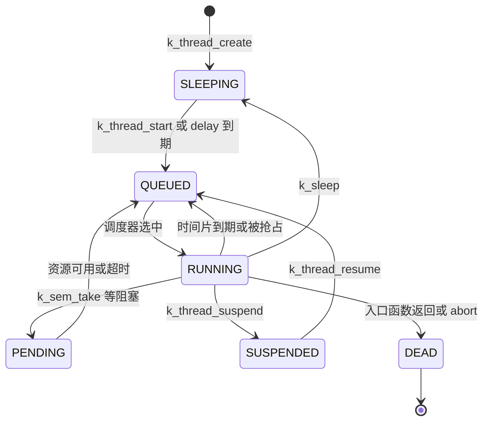
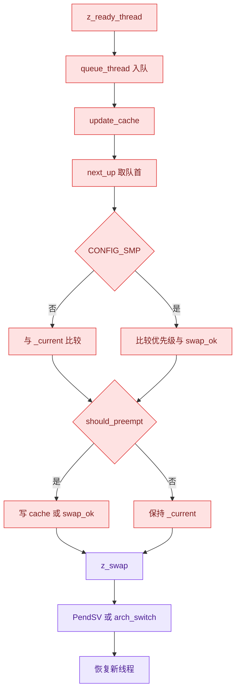

# Zephyr 源码详解 02：线程与调度

> 涉及文件：
> - `include/zephyr/kernel/thread.h`（`struct k_thread`，417 行）
> - `include/zephyr/kernel_structs.h`（状态位、`_ready_q`，387 行）
> - `kernel/sched.c`（调度决策，1006 行）
> - `kernel/thread.c`（线程生命周期，1924 行）
> - `kernel/include/run_q.h`（108 行）、`priority_q.h`（404 行）
> - `kernel/timeslicing.c`（220 行）
> - `arch/arm/core/cortex_m/swap_helper.S`（375 行）
> - KB：`../../../05-学习笔记与知识库/Knowledge-Base/zephyr/sched.md`、`../../../05-学习笔记与知识库/Knowledge-Base/zephyr/thread.md`

---

## 1. 优先级模型

`include/zephyr/kernel.h:78-101`：

```c
#define K_PRIO_COOP(x) (-(CONFIG_NUM_COOP_PRIORITIES - (x)))
#define K_PRIO_PREEMPT(x) (x)
#define K_HIGHEST_THREAD_PRIO (-CONFIG_NUM_COOP_PRIORITIES)
#define K_LOWEST_THREAD_PRIO CONFIG_NUM_PREEMPT_PRIORITIES
#define K_IDLE_PRIO K_LOWEST_THREAD_PRIO
#define K_LOWEST_APPLICATION_THREAD_PRIO (K_LOWEST_THREAD_PRIO - 1)
```

默认配置（`kernel/Kconfig:26-58`）：

| 符号 | 默认 | 范围 | 含义 |
|---|---|---|---|
| `NUM_COOP_PRIORITIES` | 16 | 0~128 | 协作线程档位 |
| `NUM_PREEMPT_PRIORITIES` | 15 | 0~127 | 抢占线程档位 |
| `K_HIGHEST_THREAD_PRIO` | -16 | — | 最高 |
| `K_PRIO_COOP(0)` ~ `K_PRIO_COOP(15)` | -16 ~ -1 | — | 协作 |
| `K_PRIO_PREEMPT(0)` ~ `(14)` | 0 ~ 14 | — | 抢占 |
| `K_IDLE_PRIO` | 15 | — | idle 专用 |

总档位 `K_NUM_THREAD_PRIO`（`kernel_structs.h:38`）：

```c
#define K_NUM_THREAD_PRIO (CONFIG_NUM_PREEMPT_PRIORITIES + CONFIG_NUM_COOP_PRIORITIES + 1)
```

默认 15+16+1 = **32**。三条规则：

1. **数值越小优先级越高**；
2. **负数 = 协作线程**，不会被同优先级或时间片抢占；
3. **同优先级抢占线程按时间片轮转**。

---

## 2. `struct k_thread`

### 2.1 字段

`thread.h:46-134` 的 `_thread_base` 是调度器真正读写的部分：

| 字段 | 行号 | 作用 |
|---|---|---|
| `qnode_dlist`/`qnode_rb` | 49-52 | 就绪/等待队列节点 |
| `pended_on` | 57 | 当前阻塞的 wait_q |
| `prio`+`sched_locked` | 76-87 | 优先级 + 调度锁，可整体按 `preempt` 比较 |
| `prio_deadline` | 90 | EDF 截止期 |
| `order_key` | 94 | 红黑树 FIFO 序号 |
| `thread_state` | 98 | 8 个状态位 |
| `cpu_mask` | 114 | CPU 亲和性 |
| `swap_data` | 118 | 唤醒传参槽 |
| `timeout` | 122 | 超时节点 |
| `slice_ticks` | 126 | 每线程时间片 |
| `usage` | 132 | 运行统计 |

`struct k_thread` 其余部分（`thread.h:258-411`）：`callee_saved`（寄存器）、
`join_queue`（join 等待队列）、`switch_handle`（架构上下文句柄）、
`stack_info`（栈边界）、`resource_pool`（线程堆）、
`held_mutexes`/`orig_prio`（优先级继承）。

**最巧妙的一处**是 `prio` 与 `sched_locked` 的 union（`thread.h:76-87`）：

```c
	union {
		struct {
#ifdef CONFIG_BIG_ENDIAN
			uint8_t sched_locked;
			int8_t prio;
#else /* Little Endian */
			int8_t prio;
			uint8_t sched_locked;
#endif /* CONFIG_BIG_ENDIAN */
		};
		uint16_t preempt;
	};
```

`_NON_PREEMPT_THRESHOLD = 0x0080`（`kernel_structs.h:86`）。
一次 16 位比较即可判断"协作线程或调度锁非零"：

```c
thread_is_preemptible(t)  ⇔  t->base.preempt < 0x0080
```

### 2.2 状态位

`kernel_structs.h:55-76` 定义 8 个位：

| 位 | 名称 | 含义 |
|---|---|---|
| 0 | `_THREAD_DUMMY` | 伪线程 |
| 1 | `_THREAD_PENDING` | 等待对象 |
| 2 | `_THREAD_SLEEPING` | 睡眠 |
| 3 | `_THREAD_DEAD` | 已终止 |
| 4 | `_THREAD_SUSPENDED` | 被挂起 |
| 5 | `_THREAD_ABORTING` | 正在 abort |
| 6 | `_THREAD_SUSPENDING` | 正在 suspend |
| 7 | `_THREAD_QUEUED` | 在就绪队列 |



`_THREAD_QUEUED` 与 `_THREAD_PENDING` 不会同时为真：
`add_to_waitq_locked()` 先 `unready_thread()` 再
`z_mark_thread_as_pending()`（`sched.c:449-463`），同一临界区内完成。

### 2.3 大小

| 部分 | 32 位字节 |
|---|---|
| `_thread_base` | ~40 |
| `callee_saved` | 32~64 |
| `join_queue` | 4~8 |
| `stack_info` | 12~24 |
| `switch_handle`+`swap_retval` | 8 |
| `resource_pool` | 4 |
| `arch` | 8~16 |
| **合计** | **约 120~160 B**（不含栈） |

---

## 3. 就绪队列

### 3.1 统一入口

`run_q.h:86-106`：

```c
static ALWAYS_INLINE void queue_thread(struct k_thread *thread)
{
	z_mark_thread_as_queued(thread);
	if (should_queue_thread(thread)) {
		runq_add(thread);
	}
#ifdef CONFIG_SMP
	if (thread == _current) {
		/* add current to end of queue means "yield" */
		_current_cpu->swap_ok = true;
	}
#endif /* CONFIG_SMP */
}

static ALWAYS_INLINE void dequeue_thread(struct k_thread *thread)
{
	z_mark_thread_as_not_queued(thread);
	if (should_queue_thread(thread)) {
		runq_remove(thread);
	}
}
```

`should_queue_thread()`（`run_q.h:81-84`）在 SMP 下返回
`thread != _current`：**当前线程不入队**，切换时才补入。单核则
永远入队，架构切换代码不必负责放回 `_current`。

### 3.2 三种实现

`priority_q.h:13-46` 用宏在编译期切换：

| 实现 | 结构 | add | best | 内存 |
|---|---|---|---|---|
| `SCHED_SIMPLE`（**默认**） | 有序 dlist | O(n) | O(1) | 8 B |
| `SCHED_SCALABLE` | 红黑树 | O(log n) | O(log n) | ~40 B + 节点 |
| `SCHED_MULTIQ` | 32 条链表 + 位图 | O(1) | O(1) | 264 B |

默认是 `SCHED_SIMPLE`（`kernel/Kconfig:271-273`）。
`_priq_mq`（`kernel_structs.h:122-128`）：

```c
struct _priq_mq {
	sys_dlist_t queues[K_NUM_THREAD_PRIO];
	unsigned long bitmask[PRIQ_BITMAP_SIZE];
#ifndef CONFIG_SMP
	unsigned int cached_queue_index;
#endif
};
```

### 3.3 同优先级 FIFO

`SCHED_MULTIQ` 下 `z_priq_mq_add()`（`priority_q.h:316-329`）
直接 `sys_dlist_append`，同优先级排队尾，不插队。
`SCHED_SCALABLE` 用 `order_key` 实现 FIFO（`priority_q.h:207-228`），
回绕时遍历整棵树重编号，最坏 O(n log n)。

### 3.4 优先级比较

`priority_q.h:81-112`：

```c
static ALWAYS_INLINE int32_t z_sched_prio_cmp(struct k_thread *thread_1, struct k_thread *thread_2)
{
	/* `prio` is <32b, so the below cannot overflow. */
	int32_t b1 = thread_1->base.prio;
	int32_t b2 = thread_2->base.prio;

	if (b1 != b2) {
		return b2 - b1;
	}

#ifdef CONFIG_SCHED_DEADLINE
	...
	uint32_t d1 = thread_1->base.prio_deadline;
	uint32_t d2 = thread_2->base.prio_deadline;

	if (d1 != d2) {
		...
		return (int32_t)(d2 - d1);
	}
#endif /* CONFIG_SCHED_DEADLINE */
	return 0;
}
```

返回值语义同 `memcmp`：`> 0` 表示 thread_1 更高。
`(int32_t)(d2 - d1)` 用无符号减法避免有符号溢出 UB。

---

## 4. 选下一个线程：`next_up()`

### 4.1 单核

`sched.c:86-97`：

```c
	struct k_thread *thread = runq_best();

	thread = metairq_preempt_recover(thread);

#ifndef CONFIG_SMP
	/* In uniprocessor mode, we can leave the current thread in
	 * the queue (actually we have to, otherwise the assembly
	 * context switch code for all architectures would be
	 * responsible for putting it back in z_swap and ISR return!),
	 * which makes this choice simple.
	 */
	return (thread != NULL) ? thread : _current_cpu->idle_thread;
#else
```

### 4.2 SMP

`sched.c:110-143`：

```c
	bool queued = z_is_thread_queued(_current);
	bool active = z_is_thread_ready(_current);

	if (thread == NULL) {
		thread = _current_cpu->idle_thread;
	}

	if (active) {
		int32_t cmp = z_sched_prio_cmp(_current, thread);

		/* Ties only switch if state says we yielded */
		if ((cmp > 0) || ((cmp == 0) && !_current_cpu->swap_ok)) {
			thread = _current;
		}

		if (!should_preempt(thread, _current_cpu->swap_ok)) {
			thread = _current;
		}
	}

	if (thread != _current) {
		update_metairq_preempt(thread);
		/*
		 * Put _current back into the queue unless it is ..
		 * 1. not active (i.e., blocked, suspended, dead), or
		 * 2. already queued, or
		 * 3. the idle thread, or
		 * 4. preempted by a MetaIRQ thread
		 */
		if (active && !queued && !z_is_idle_thread_object(_current)
		    && metairq_current_requeue_allowed()) {
			queue_thread(_current);
		}
	}
```

SMP 的复杂度来自"当前线程不在队列中"：同优先级只有
`swap_ok` 为真（主动 yield）才切；真切换时把 `_current` 补回队列，
再把新线程摘出。

### 4.3 `update_cache`

`sched.c:179-205`：

```c
static ALWAYS_INLINE void update_cache(int preempt_ok)
{
#ifndef CONFIG_SMP
	struct k_thread *thread = next_up();

	if (should_preempt(thread, preempt_ok)) {
#ifdef CONFIG_TIMESLICING
		if (thread != _current) {
			z_time_slice_reset(thread);
		}
#endif /* CONFIG_TIMESLICING */
		update_metairq_preempt(thread);
		_kernel.ready_q.cache = thread;
	} else {
		_kernel.ready_q.cache = _current;
	}
#else
	_current_cpu->swap_ok = preempt_ok;
#endif /* CONFIG_SMP */
}
```

单核的 `ready_q.cache` 就是"下次 `z_swap` 去哪"；
`need_swap()`（`sched.c:401-413`）只比较 `cache != _current`。



---

## 5. 上下文切换

### 5.1 通用层

`z_get_next_switch_handle()`（`sched.c:737-811`）单核分支只有 6 行：

```c
#else
	struct k_thread *next = _kernel.ready_q.cache;

	z_sched_usage_switch(next);
	_current->switch_handle = interrupted;
	set_current(next);
	return next->switch_handle;
#endif /* CONFIG_SMP */
```

SMP 分支在调度锁内做同样的事，额外处理：

```c
		if (old_thread != new_thread) {
			uint8_t  cpu_id;

			z_sched_switch_spin(new_thread);
			arch_cohere_stacks(old_thread, interrupted, new_thread);

			_current_cpu->swap_ok = 0;
			cpu_id = arch_curr_cpu()->id;
			new_thread->base.cpu = cpu_id;
			set_current(new_thread);
			...
			if (z_is_thread_queued(old_thread)) {
				...
				runq_add(old_thread);
			}
		}
		old_thread->switch_handle = interrupted;
		ret = new_thread->switch_handle;
		/* Active threads MUST have a null here */
		new_thread->switch_handle = NULL;
```

（`sched.c:754-795` 节选）

`switch_handle` 是架构私有句柄：Cortex-M 上是 PSP，RISC-V 上是 sp。
切换分两步：调用方保存寄存器并把栈顶作为 `interrupted` 传入；
本函数返回新线程的 `switch_handle`，架构代码用它恢复栈。

### 5.2 Cortex-M：PendSV

`swap_helper.S:35-46` 的注释：

```asm
 * @brief PendSV exception handler, handling context switches
 *
 * The PendSV exception is the only execution context in the system that can
 * perform a context switch, it pends the PendSV exception.
 *
 * When PendSV is pended, the decision that a context switch must happen has
 * already been taken. In other words, when z_arm_pendsv() runs, we *know* a
```

`z_swap()` 不直接切栈，而是置 PendSV pending。PendSV 优先级最低，
可被更高优先级中断抢占，保证切换不延迟中断响应；代价是切换延迟
包含一次异常进入 + 一次异常退出（M3 上约 12+12 周期）。

### 5.3 数据流


---

## 6. 时间片

`timeslicing.c:44-64`：

```c
static int z_time_slice_size(struct k_thread *thread)
{
	if (z_is_thread_prevented_from_running(thread) ||
	    z_is_idle_thread_object(thread) ||
	    (slice_time(thread) == 0)) {
		return 0;
	}

#ifdef CONFIG_TIMESLICE_PER_THREAD
	if (thread->base.slice_ticks != 0) {
		return thread->base.slice_ticks;
	}
#endif

	if (thread_is_preemptible(thread) &&
	    !z_is_prio_higher(thread->base.prio, slice_max_prio)) {
		return slice_ticks;
	}

	return 0;
}
```

只有"可抢占且优先级不高于 `slice_max_prio`"的线程参与轮转。
时间片用 timeout 实现，不用 tick 钩子（`timeslicing.c:66-101`）：

```c
static void slice_timeout(struct _timeout *timeout)
{
	int cpu = ARRAY_INDEX(slice_timeouts, timeout);

	atomic_set(&slice_expired[cpu], 1);

	/* We need an IPI if we just handled a timeslice expiration
	 * for a different CPU.
	 */
	if (cpu != _current_cpu->id) {
		flag_ipi(IPI_CPU_MASK(cpu));
	}
}
```

`delay = slice_size - 1`（`timeslicing.c:95`）补偿
`z_add_timeout()` 内部的 "+1" 取整，保证正好 `slice_size` tick。
精度 = 1 tick；`CONFIG_SYS_CLOCK_TICKS_PER_SEC=100` 时最小片 10 ms。

---

## 7. SMP 要点

| 机制 | 代码 | 作用 |
|---|---|---|
| 每 CPU 队列 | `CONFIG_SCHED_CPU_MASK_PIN_ONLY` | 绑定单核时每核一条 |
| 全局队列 | 默认 | 所有核抢 `_sched_spinlock` |
| `swap_ok` | `sched.c:203` | 本核是否允许协作切换 |
| IPI | `flag_ipi()` | 唤醒/改优先级后通知其他核 |
| `halt_queue` | `thread.h:381` | 跨核 suspend 同步 |

最反直觉的一点：**SMP 下 `_current` 不在就绪队列里**。
`z_ready_thread()` 先 `thread_active_elsewhere()` 判断目标是否
正在别的核上跑，是则只发 IPI，不重复入队（`sched.c:211-256`）。

---

## 8. 陷阱

1. **`K_PRIO_COOP(0)` 是 -16，不是 0**。写成 `0` 语义完全不同。
2. **同优先级不会互相抢占**，只有时间片到期才轮转。
3. **`k_sched_lock()` 不是互斥锁**，只阻止本线程被抢占。
4. **SMP 下 `z_thread_prio_set()` 对运行中线程只改字段**，
   降低别的核上的线程优先级要发 IPI 才生效（`sched.c:616-632`）。
5. **`CONFIG_NUM_COOP_PRIORITIES=0`** 时 `K_PRIO_COOP(x)` 编译失败。

---

## 9. 读码路径

```
kernel.h:78           优先级宏
thread.h:76           prio/sched_locked union
thread.h:258          struct k_thread
kernel_structs.h:55   状态位
run_q.h:86            queue_thread
priority_q.h:316      z_priq_mq_add
sched.c:69            next_up
sched.c:179           update_cache
sched.c:737           z_get_next_switch_handle
timeslicing.c:44      z_time_slice_size
swap_helper.S:48      z_arm_pendsv
```

> 下一篇：`03-同步原语.md`，看 `k_mutex` 的优先级继承链怎么走。
