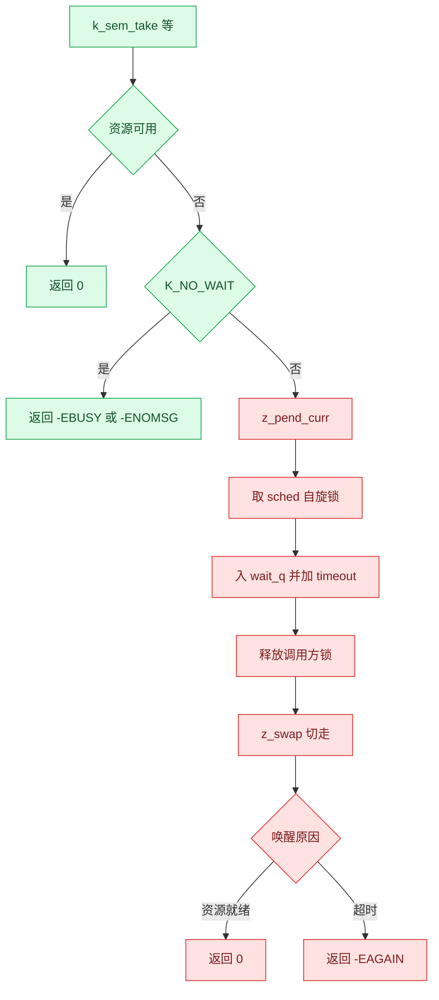
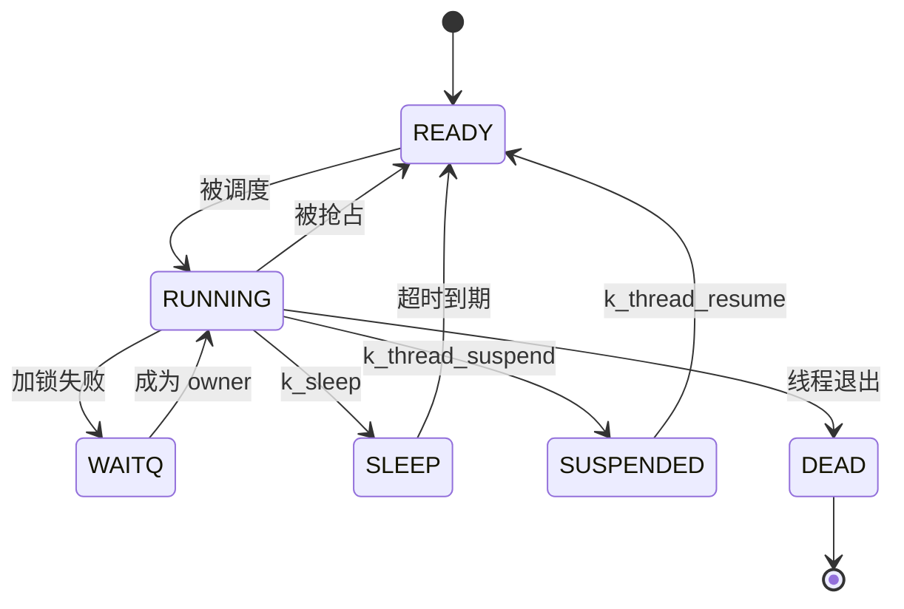

# Zephyr 源码详解 03：同步原语

> 涉及文件：
> - `kernel/mutex.c`（`k_mutex` + 优先级继承，497 行）
> - `kernel/sem.c`（231 行）、`kernel/condvar.c`（148 行）
> - `kernel/events.c`（431 行）、`kernel/userspace/futex.c`（223 行）
> - `include/zephyr/kernel.h`（对象结构）
> - KB：`../../../05-学习笔记与知识库/Knowledge-Base/zephyr/mutex.md`

---

## 1. 五种原语的分工

| 原语 | 语义 | 递归 | 优先级继承 | ISR 可用 | 场景 |
|---|---|---|---|---|---|
| `k_spinlock` | 忙等自旋锁 | 否 | 否 | 是 | 短临界区 |
| `k_mutex` | 互斥 + 所有权 | 是 | **是** | 否 | I2C 总线等慢资源 |
| `k_sem` | 计数信号量 | 否 | 否 | `give` 可以 | 生产者/消费者 |
| `k_condvar` | 条件变量 + mutex | 否 | 借 mutex | 否 | 等谓词成立 |
| `k_event` | 32 位事件标志 | 否 | 否 | `post` 可以 | 多事件组合 |
| `k_futex` | 用户态快速互斥 | 否 | 否 | 否 | pthread |

选择顺序：

```
需要"谁持有" → k_mutex
只需计数/通知 → k_sem
需要 A 且 B → k_event
需要等谓词且配 mutex → k_condvar
ISR 与线程共享数据 → k_spinlock
```

---

## 2. `k_mutex`

### 2.1 结构

`include/zephyr/kernel.h:3500-3523`：

```c
struct k_mutex {
	/** Mutex wait queue */
	_wait_q_t wait_q;
	/** Mutex owner */
	struct k_thread *owner;

	/** Current lock count */
	uint32_t lock_count;

#if Z_MUTEX_PI_ENABLED
	/** Node for linking this mutex into the owner thread's held_mutexes list */
	sys_snode_t held_node;
#endif /* Z_MUTEX_PI_ENABLED */

#ifdef CONFIG_OBJ_CORE_MUTEX
	struct k_obj_core obj_core;
#endif
};
```

32 位下 **20 B**（wait_q 8 + owner 4 + count 4 + held_node 4）。
`lock_count` 支持递归；同线程重复加锁只加计数。

### 2.2 全局锁

`mutex.c:73-80`：

```c
/*
 * We use a global spinlock rather than a per-object lock because the
 * priority-inheritance chain walk, the held-mutexes recalculation, the
 * K_FOREVER deadlock check, and the unlock handoff all read or write
 * fields (owner, mutex_pended_on, held_mutexes) belonging to mutexes
 * other than the one passed to the API entry point.
 */
static struct k_spinlock mutex_lock;
```

继承链要跨多个 mutex，所以锁必须覆盖整条链。代价是任意两个
mutex 操作在 SMP 上互相串行。

### 2.3 加锁三分支

`mutex.c:177-220`：

```c
int z_impl_k_mutex_lock(struct k_mutex *mutex, k_timeout_t timeout)
{
	k_spinlock_key_t key;
#if Z_MUTEX_PI_ENABLED
	bool resched = false;
#endif

	__ASSERT(!arch_is_in_isr(), "mutexes cannot be used inside ISRs");

	SYS_PORT_TRACING_OBJ_FUNC_ENTER(k_mutex, lock, mutex, timeout);

	key = k_spin_lock(&mutex_lock);

	if (likely((mutex->lock_count == 0U) || (mutex->owner == _current))) {

		mutex->lock_count++;
		mutex->owner = _current;
		...
		return 0;
	}

	if (unlikely(K_TIMEOUT_EQ(timeout, K_NO_WAIT))) {
		k_spin_unlock(&mutex_lock, key);
		...
		return -EBUSY;
	}
```

1. 无人持有 → 直接拿；
2. 自己持有 → 递归 +1；
3. 别人持有 → `K_NO_WAIT` 返回 `-EBUSY`，否则继承 + 阻塞。

### 2.4 继承链

`mutex.c:240-311`：

```c
	{
		int32_t boost_prio = new_prio_for_inheritance(
					_current->base.prio,
					mutex->owner->base.prio);
		struct k_mutex  *chain_mutex = mutex;
		struct k_thread *chain_owner = mutex->owner;
		int hops = 0;
#if defined(CONFIG_MUTEX_DEADLOCK_DETECT)
		bool all_forever = K_TIMEOUT_EQ(timeout, K_FOREVER);
#endif

		LOG_DBG("chain boosting prio on mutex %p", mutex);

		while (chain_owner != NULL) {
#if defined(CONFIG_MUTEX_DEADLOCK_DETECT)
			...
			all_forever = all_forever &&
				      z_is_inactive_timeout(&chain_owner->base.timeout);

			if (all_forever &&
			    chain_owner->mutex_pended_on != NULL &&
			    z_is_thread_pending(chain_owner) &&
			    chain_owner->mutex_pended_on->owner == _current) {
				__ASSERT(false,
					"mutex deadlock: thread %p waiting on "
					"mutex %p (owner %p)",
					_current, mutex, mutex->owner);
				break;
			}
#endif /* CONFIG_MUTEX_DEADLOCK_DETECT */

			if (z_is_prio_higher(boost_prio, chain_owner->base.prio)) {
				resched = adjust_owner_prio(chain_mutex, boost_prio)
					  || resched;
			}

			/*
			 * Stop the chain walk if the owner is not actually
			 * pending — its mutex_pended_on may be stale (e.g. it
			 * just timed out but has not yet cleared the field).
			 * Always boost the current owner first, then decide
			 * whether to continue.
			 */
			if (chain_owner->mutex_pended_on == NULL ||
			    !z_is_thread_pending(chain_owner)) {
				break;
			}

			chain_mutex = chain_owner->mutex_pended_on;
			/*
			 * Cap the walk to prevent spinning on a cycle that
			 * does not pass through the starting mutex.
			 * MUTEX_CHAIN_WALK_MAX_HOPS bounds walk cost under
			 * mutex_lock; it is not a real limit on chain length.
			 * The chain_mutex == mutex check is a fast path for
			 * the common 2-hop cycle through the starting mutex.
			 */
			if (chain_mutex == mutex ||
			    ++hops >= MUTEX_CHAIN_WALK_MAX_HOPS) {
				break;
			}
			chain_owner = chain_mutex->owner;
		}
	}
```

`boost_prio` 初值 = `max(等待者优先级, owner 优先级)`，
再经 `z_get_new_prio_with_ceiling()` 夹到 `CONFIG_PRIORITY_CEILING`
（默认 -128）。每跳只升不降。

| 线程 | 原优先级 | 等待 | 提升后 |
|---|---|---|---|
| H | 2 | mutex A（M 持有） | 2 |
| M | 8 | mutex B（L 持有） | 2 |
| L | 14 | 运行临界区 | 2 |

`MUTEX_CHAIN_WALK_MAX_HOPS = 16`（`mutex.c:123`）是**走链成本上限**，
不是链长上限；超过 16 跳的 owner 保持原优先级。

### 2.5 解锁交接

`mutex.c:446-475`：

```c
	/* Pick the new owner (if any) and complete the wake atomically
	 * under the scheduler's spinlock, so a racing in-flight timeout
	 * handler cannot observe a half-initialized wake-up.
	 */
	LOCK_SCHED_SPINLOCK {
		new_owner = z_unpend_first_thread_locked(&mutex->wait_q);
		mutex->owner = new_owner;

		LOG_DBG("new owner of mutex %p: %p (prio: %d)",
			mutex, new_owner, new_owner ? new_owner->base.prio : -1000);

		if (unlikely(new_owner != NULL)) {
			/*
			 * new owner is already of higher or equal prio than first
			 * waiter since the wait queue is priority-based: no need to
			 * adjust its priority
			 */
#if Z_MUTEX_PI_ENABLED
			if (sys_slist_is_empty(&new_owner->held_mutexes)) {
				new_owner->orig_prio = new_owner->base.prio;
			}
			sys_slist_append(&new_owner->held_mutexes, &mutex->held_node);
			new_owner->mutex_pended_on = NULL;
#endif
			arch_thread_return_value_set(new_owner, 0);
			z_sched_ready_locked(new_owner);
		} else {
			mutex->lock_count = 0U;
		}
	}
```

三个细节：**直接交接**（不等 waiter 重抢）、
**`arch_thread_return_value_set(...0)`**（让 lock 返回 0）、
**`held_mutexes` 链表**（解锁时重算优先级）。

### 2.6 已知限制（官方注释）

`mutex.c:34-54`：

```c
 * Known limitations:
 * - Bounded chain walk: the ownership-chain walk stops after
 *   MUTEX_CHAIN_WALK_MAX_HOPS hops. Owners beyond that hop count keep their
 *   pre-boost priority. This is a deliberate bound on the work done under
 *   mutex_lock, not a claim that chains longer than the limit cannot
 *   legally form.
 * - Deferred priority drop on timeout: when a waiter times out, the owner's
 *   priority is adjusted in the waiter's context after it resumes, not at ISR
 *   level. The owner may run at a slightly higher priority than it should for
 *   a short time, but all threads will eventually run correctly.
```

这解释了为什么超时返回后还要再拿 `mutex_lock` 重算一次
owner 优先级（`mutex.c:334-364`）：降优先级不能在 timeout ISR 做，
否则会与 `k_mutex_unlock()` 的锁顺序形成死锁。


---

## 3. `k_sem`

### 3.1 结构与语义

`kernel.h:3738-3754` 只有 `wait_q` + `count` + `limit`（16 B）。
`give`（`sem.c:121-143`）优先直接唤醒 waiter，给不出去才加计数：

```c
	if (z_sched_wake(&sem->wait_q, 0, NULL)) {
		resched = true;
	} else {
		sem->count += (sem->count != sem->limit) ? 1U : 0U;
		resched = sem_handle_poll_events(sem);
	}
```

计数达到 `limit` 后 `+= 0`，**静默丢弃**——不返回错误。
这是 `k_sem` 与 `k_msgq`（返回 `-ENOMSG`）的重要区别。

`take`（`sem.c:154-187`）在 `K_NO_WAIT` 下返回 `-EBUSY`，
否则 `z_pend_curr()` 阻塞。超时返回 `-EAGAIN`。

### 3.2 锁分片

`sem.c:52-65`：

```c
static inline struct k_spinlock *sem_spinlock_get(struct k_sem *sem)
{
#if defined(CONFIG_SMP) && (CONFIG_SEM_LOCK_STRIPES > 1)
	BUILD_ASSERT(IS_POWER_OF_TWO(CONFIG_SEM_LOCK_STRIPES),
		     "CONFIG_SEM_LOCK_STRIPES must be a power of two");

	/* Hash the naturally aligned semaphore address into a lock stripe. */
	return &sem_locks[((uintptr_t)sem / __alignof(struct k_sem)) %
			  CONFIG_SEM_LOCK_STRIPES];
#else
	ARG_UNUSED(sem);
	return &sem_lock;
#endif
}
```

默认一把全局锁；SMP 高并发可调到 8/16 减少争用。

---

## 4. `k_condvar`

`kernel.h:3633-3645` 只有一条 `wait_q`，互斥完全委托给调用方传入的
mutex。`wait` 的三步（`condvar.c:105-138`）：

```c
	key = k_spin_lock(&condvar_lock);
	k_mutex_unlock(mutex);

	ret = z_pend_curr(&condvar_lock, key, &condvar->wait_q, timeout);

	/* Always re-acquire the mutex before returning, even on timeout.
	 * This matches POSIX semantics: the mutex must be locked by the
	 * calling thread when pthread_cond_wait() returns, regardless of
	 * whether it was signaled or timed out.
	 */
	k_mutex_lock(mutex, K_FOREVER);
```

原子性：`signal()` 也要先拿 `condvar_lock`（`condvar.c:46`），
所以"解锁 → 挂起"之间 signal 插不进来。
返回时**一定重新持有 mutex**，即使超时；调用方必须用
`while (!condition)` 而不是 `if`。

---

## 5. `k_event`

`kernel.h:2695-2709`：`wait_q` + `events` + `lock`（约 20 B）。
等待条件（`events.c:96-108`）：

```c
static uint32_t are_wait_conditions_met(uint32_t desired, uint32_t current,
					unsigned int wait_condition)
{
	uint32_t match = current & desired;

	if ((wait_condition == K_EVENT_WAIT_ALL) && (match != desired)) {
		/* special case for K_EVENT_WAIT_ALL */
		return 0;
	}

	/* return the matched events for any wait condition */
	return match;
}
```

- `WAIT_ANY`：`current & desired != 0`；
- `WAIT_ALL`：`current & desired == desired`。

`post` 是两阶段唤醒（`events.c:195-214`）：先遍历 wait_q 把满足条件的
线程串到 `next_wake_link`，遍历完再统一唤醒。原因：
`CONFIG_WAITQ_SCALABLE` 的红黑树在遍历时不能删节点。

---

## 6. `k_futex`

`futex.c:17-37` 的设计取舍：

```c
/*
 * Kernel futex implementation
 *
 * We use a single queue for all futex waiters. This is lightweight and
 * efficient for a small number of threads but does not scale well to larger
 * numbers waiting on different futexes, because each wake needs to walk the
 * full queue while holding _sched_spinlock.
 ...
 */
static _wait_q_t futex_wait_q = Z_WAIT_Q_INIT(&futex_wait_q);
static struct k_spinlock futex_lock;
```

所有 futex 共用一条 `wait_q`，靠 `thread->futex_pointer` 过滤。
`wake` 是 O(等待线程总数)。

`wait`（`futex.c:187-213`）在同一临界区内完成"比较值 + 挂起"：

```c
	key = k_spin_lock(&futex_lock);

	if (atomic_get(&futex->val) != (atomic_val_t)expected) {
		k_spin_unlock(&futex_lock, key);
		return -EAGAIN;
	}

	_current->futex_pointer = futex;
	...
	ret = z_pend_curr(&futex_lock, key, &futex_wait_q, timeout);
	if (ret == -EAGAIN) {
		ret = -ETIMEDOUT;
	}
```

否则会丢失唤醒。

---

## 7. 统一底座

所有原语最终只做三件事：

| 动作 | 函数 | 位置 |
|---|---|---|
| 挂起当前线程 | `z_pend_curr(lock, key, wait_q, timeout)` | `sched.c:534` |
| 取 wait_q 队首 | `z_unpend_first_thread_locked(wait_q)` | `sched.c:567` 附近 |
| 重调度 | `z_reschedule(lock, key)` | `sched.c:415` |

`z_pend_curr()` 的三个关键动作（`sched.c:534-565`）：

```c
	if (arch_is_in_isr()) {
		__ASSERT(false, "blocking pend from ISR context");
		k_panic();
	}
	...
	(void) z_sched_spinlock_lock();
	pend_locked(_current, wait_q, timeout);
	k_spin_release(lock);
	return z_swap_locked(key);
```

1. ISR 里阻塞直接 panic；
2. 线程入 wait_q、加 timeout、移出就绪队列；
3. **释放调用方的锁**（"锁交换"），再 `z_swap`。





---

## 8. 量化

| 原语 | 32 位大小 | 等待最坏复杂度 | 唤醒复杂度 |
|---|---|---|---|
| `k_spinlock` | 0（UP）/4（SMP） | O(1) 忙等 | — |
| `k_mutex` | 20 B | O(链长)，≤16 跳 | O(1)/O(log n) |
| `k_sem` | 16 B | O(1) | O(1)/O(log n) |
| `k_condvar` | 8 B | O(1)+mutex | O(1)/O(log n) |
| `k_event` | 20 B | O(1) 判断 | O(n) 遍历 |
| `k_futex` | 4 B/地址 | O(1) | O(全部 waiter) |

---

## 9. 陷阱

1. **`k_sem_give()` 计数满时静默丢失**；需要"不丢"就用 `k_event`。
2. **`k_mutex` 不能在 ISR 用**（`mutex.c:184` assert）。
3. **`k_condvar_wait()` 必须放在 `while` 循环**，可能 spurious wakeup。
4. **死锁检测仅在 `CONFIG_MUTEX_DEADLOCK_DETECT=y` 且 `CONFIG_ASSERT=y`**，
   且只检测"整条链都 K_FOREVER"的环。
5. **优先级继承不跨 `k_sem`**，用 sem 保护资源仍可能优先级反转。
6. **`k_event` 的 `CLEAR` 会消耗事件位**，多等待者只有第一个拿到。

---

## 10. 读码路径

```
kernel.h:3500        k_mutex
mutex.c:177          k_mutex_lock
mutex.c:240          继承链
mutex.c:446          unlock 交接
kernel.h:3738        k_sem
sem.c:121            give
condvar.c:105        k_condvar_wait
events.c:96          等待条件
futex.c:187          k_futex_wait
sched.c:534          z_pend_curr
```

> 下一篇：`04-通信机制.md`，看 msgq/fifo/pipe/mbox 与内存池。
