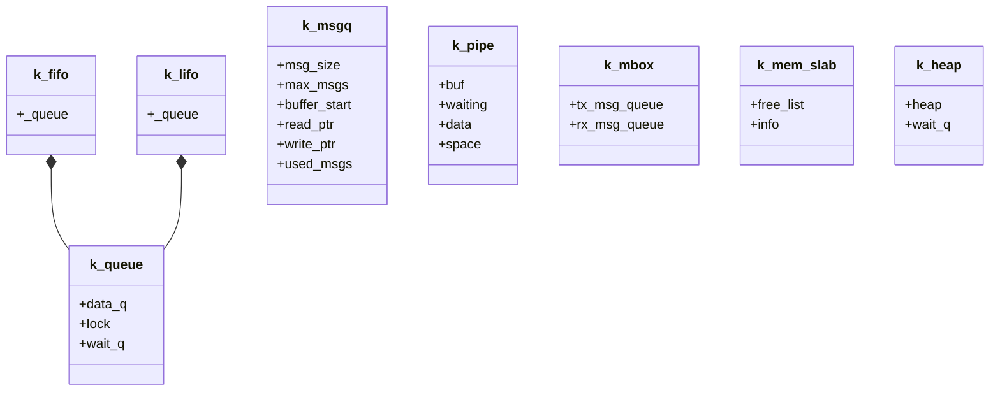
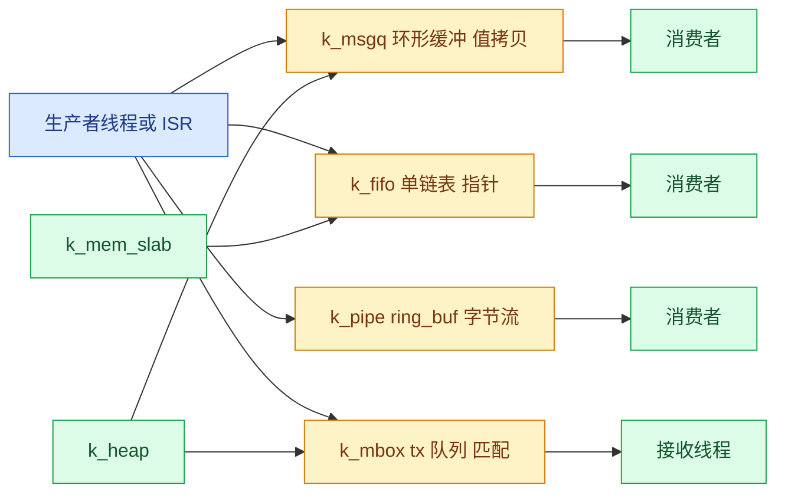
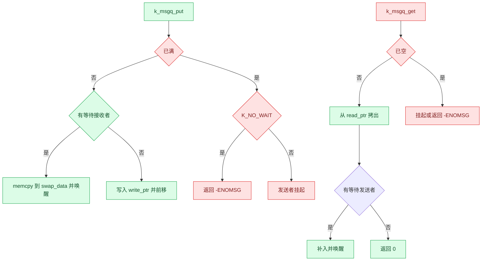

# Zephyr 源码详解 04：通信机制与内存池

> 涉及文件：
> - `kernel/msg_q.c`（552 行）、`kernel/queue.c`（506 行）
> - `kernel/pipe.c`（356 行）、`kernel/mailbox.c`（515 行）
> - `kernel/mem_slab.c`（336 行）、`kernel/kheap.c`（193 行）
> - `kernel/mempool.c`（226 行）、`include/zephyr/kernel.h`
> - KB：`../../../05-学习笔记与知识库/Knowledge-Base/zephyr/msgq.md`、`../../../05-学习笔记与知识库/Knowledge-Base/zephyr/k_heap.md`

---

## 1. 四种通信原语

| 原语 | 数据形态 | 拷贝次数 | 阻塞点 | 用途 |
|---|---|---|---|---|
| `k_msgq` | 定长消息，值拷贝 | 1~2 | 满/空 | 采样、命令字 |
| `k_fifo`/`k_lifo` | 任意指针 | 0 | 空 | 内存块传递 |
| `k_pipe` | 字节流，可部分读写 | 1~2 | 满/空 | 串口透传 |
| `k_mbox` | 变长消息，可匹配 | 1 | 无数据/空间 | 请求-应答 |

选择：

```
定长小消息 → k_msgq
只传"谁" → k_fifo（零拷贝）
字节流 → k_pipe
需要发送方等接收方取走 → k_mbox 同步模式
```

---

## 2. 对象关系



`k_fifo`/`k_lifo` 是 `k_queue` 的包装（`kernel.h:2951-2963`），
API 差异只在取头还是取尾。`k_msgq` 的缓冲可以是静态数组，
也可以是 `k_malloc` 来的（`k_msgq_alloc_init`），与 slab 无强制关系。

---

## 3. `k_msgq`

### 3.1 结构

`kernel.h:5257-5290`：

```c
struct k_msgq {
	/** Message queue wait queue */
	_wait_q_t wait_q;
	/** Lock */
	struct k_spinlock lock;
	/** Message size */
	size_t msg_size;
	/** Maximal number of messages */
	uint32_t max_msgs;
	/** Start of message buffer */
	char *buffer_start;
	/** End of message buffer */
	char *buffer_end;
	/** Read pointer */
	char *read_ptr;
	/** Write pointer */
	char *write_ptr;
	/** Number of used messages */
	uint32_t used_msgs;

	Z_DECL_POLL_EVENT

	/** Message queue */
	uint8_t flags;
	...
};
```

| 字段 | 不变量 |
|---|---|
| `read_ptr`/`write_ptr` | 落在 `[buffer_start, buffer_end)` |
| `used_msgs` | `0 <= used_msgs <= max_msgs` |
| `buffer_end` | `buffer_start + max_msgs*msg_size` |

32 位下结构体约 **44 B**，缓冲另算 `msg_size × max_msgs`。

### 3.2 发送：优先 handoff

`msg_q.c:175-200`：

```c
	if (msgq->used_msgs < msgq->max_msgs) {
		/* message queue isn't full. Try to hand the message
		 * directly to the longest-waiting receiver, atomically
		 * under the scheduler's spinlock so a racing in-flight timeout
		 * handler cannot wake the receiver before the message
		 * has been copied into its buffer.
		 */
		LOCK_SCHED_SPINLOCK {
			pending_thread = z_unpend_first_thread_locked(&msgq->wait_q);
			if (pending_thread != NULL) {
				/* copy into the receiver's buffer */
				(void)memcpy(pending_thread->base.swap_data, data,
					     msgq->msg_size);
				arch_thread_return_value_set(pending_thread, 0);
				z_sched_ready_locked(pending_thread);
				resched = true;
			}
		}
```

队列没满但有人在等 → 不写环形缓冲，直接 `memcpy` 到接收者的
`swap_data`（即 `k_msgq_get()` 的 `data` 参数）。
`msg_q.c:236` 的注释解释了为什么"先更新指针再拷贝"：

```c
			/*
			 * Pick the slot and update the ring state from
			 * registers first: the compiler cannot tell that the
			 * copy leaves the queue fields alone, so copying last
			 * saves it re-reading them afterwards.
			 */
```

### 3.3 接收与补位

`msg_q.c:342-386`：

```c
	if (likely(msgq->used_msgs > 0U)) {
		size_t msg_size = msgq->msg_size;
		char *slot = msgq->read_ptr;
		char *next = slot + msg_size;

		/* drop the message from the queue, then copy it out */
		if (next == msgq->buffer_end) {
			next = msgq->buffer_start;
		}
		msgq->read_ptr = next;
		msgq->used_msgs--;

		(void)memcpy(data, slot, msg_size);
		...
		LOCK_SCHED_SPINLOCK {
			pending_thread = z_unpend_first_thread_locked(&msgq->wait_q);
			if (pending_thread != NULL) {
				...
				/* add the sender's pending message to the queue */
				slot = msgq->write_ptr;
				next = slot + msg_size;
				if (next == msgq->buffer_end) {
					next = msgq->buffer_start;
				}
				msgq->write_ptr = next;
				msgq->used_msgs++;

				(void)memcpy(slot, pending_thread->base.swap_data, msg_size);
				...
			}
		}
```

接收路径是发送的镜像：先拷出，再把等待发送者的消息补进刚腾出的槽。

### 3.4 复杂度

| 操作 | 复杂度 |
|---|---|
| `put`（无 waiter） | O(1) + 1 次 memcpy |
| `put`（有 waiter） | O(1) + 1 次 memcpy，跳过环形 |
| `get`（有补位） | O(1) + 2 次 memcpy |
| `peek_at(k)` | O(1) + memcpy，可能跨回绕 |
| `purge` | O(w)，w = 等待发送者数 |

`K_MSGQ_DEFINE(q, 32, 16, 4)`：结构体 44 B + 缓冲 512 B = **556 B**。

---

## 4. `k_fifo` / `k_lifo`

`kernel.h:2951-2963`：

```c
struct k_fifo {
	struct k_queue _queue;
#ifdef CONFIG_OBJ_CORE_FIFO
	struct k_obj_core  obj_core;
#endif
};
```

`k_queue`（`kernel.h:2325-2341`）用 `sys_sflist_t`（单链表 + 尾指针），
append/prepend/get 全 O(1)。节点直接嵌在用户数据里，零拷贝。

入队时若有人在等，直接交指针（`queue.c:163-167`）：

```c
	if (z_sched_wake(&queue->wait_q, 0, data)) {
		SYS_PORT_TRACING_OBJ_FUNC_BLOCKING(k_queue, queue_insert, queue, alloc, K_FOREVER);
		resched = true;
		goto out;
	}
```

`z_sched_wake()` 的第三个参数就是交给等待者的指针，队列连插入都省了。

**坑**：`sys_sfnode_init(data, 0x0)` 把节点标记为"未入队"。
同一对象同时放进两个 `k_fifo` 会互相覆盖 `next` 指针，表现为随机丢元素。

---

## 5. `k_pipe`

`kernel.h:5829-5853`：

```c
struct k_pipe {
	size_t waiting;
	struct ring_buf buf;
	struct k_spinlock lock;
	_wait_q_t data;
	_wait_q_t space;
	uint8_t flags;

	Z_DECL_POLL_EVENT
	...
};
```

两条等待队列：`data` 给读者等"有数据"，`space` 给写者等"有空间"。
与 msgq 单队列 + `swap_data` 区分方向不同，pipe 把读写分开，
避免唤醒错对象。

写路径（`pipe.c:179-217`）：

```c
		if (pipe_empty(pipe)) {
			if (IS_ENABLED(CONFIG_KERNEL_COHERENCE)) {
				/*
				 * Systems that enabled this option don't have
				 * their stacks in coherent memory. Given our
				 * pipe_buf_spec is stored on the stack, and
				 * readers may also have their destination
				 * buffer on their stack too, it is not worth
				 * supporting direct-to-readers copy with them.
				 * Simply wake up all pending readers instead.
				 */
				need_resched = z_sched_wake_all(&pipe->data, 0, NULL);
			} else if (pipe->waiting != 0) {
				written += copy_to_pending_readers(pipe, &need_resched,
								   &data[written],
								   len - written);
				if (written >= len) {
					rc = written;
					break;
				}
			}
		}

		added = ring_buf_put(&pipe->buf, &data[written], len - written);
		...
		rc = wait_for(&pipe->space, pipe, &key, end, &need_resched, NULL);
```

与 msgq 相同的优化：空且有读者在等时直接拷进读者缓冲。

**返回值是"实际传输字节数"**，不是 0/错误：

| 情况 | 返回值 |
|---|---|
| 全部写完 | `len` |
| 超时但写了一部分 | `written` |
| 超时且没写 | `-EAGAIN` |
| 已 close | `-EPIPE` |
| 被 reset | `-ECANCELED` |

调用方必须循环到 `written == len`。

---

## 6. `k_mbox`

`kernel.h:5669-5684`：`tx_msg_queue` + `rx_msg_queue` + `lock`。
发送线程挂在 tx，接收线程挂在 rx，通过 `mbox_message_match()`
（`mailbox.c:119`）按 `type`/`size` 匹配。同步模式下发送方一直阻塞
到接收方取走，这是与 msgq 最大的区别。

`CONFIG_NUM_MBOX_ASYNC_MSGS > 0` 时可用异步发送：
`mbox_async_alloc()`（`mailbox.c:48`）从预分配池取一个
`k_mbox_async`；池耗尽时 `k_mbox_put()` 返回 `-ENOMEM`，不阻塞。

---

## 7. 内存池

### 7.1 `k_mem_slab`

`kernel.h:5958-5968`：`wait_q` + `lock` + `buffer` + `free_list` + `info`。
空闲链表存在块内部（每块前 4 B 存下一块地址），所以
`block_size` 必须 ≥ `sizeof(char *)`，否则 `create_free_list()`
返回 `-EINVAL`（`mem_slab.c:119-122`）。

分配（`mem_slab.c:225-253`）：

```c
	if (slab->free_list != NULL) {
		/* take a free block */
		*mem = slab->free_list;
		slab->free_list = *(char **)(slab->free_list);
		slab->info.num_used++;
		__ASSERT((slab->free_list == NULL &&
			  slab->info.num_used == slab->info.num_blocks) ||
			 slab_ptr_is_good(slab, slab->free_list),
			 "slab corruption detected");
		...
		result = 0;
	} else if (K_TIMEOUT_EQ(timeout, K_NO_WAIT) ||
		   !IS_ENABLED(CONFIG_MULTITHREADING)) {
		/* don't wait for a free block to become available */
		*mem = NULL;
		result = -ENOMEM;
	} else {
		...
		result = z_pend_curr(&slab->lock, key, &slab->wait_q, timeout);
		if (result == 0) {
			*mem = _current->base.swap_data;
		}
		...
	}
```

O(1)，无外部碎片；`free` 也优先直接交给等待者
（`mem_slab.c:282-288`）。

### 7.2 `k_heap`

`kernel.h:6295-6306`：`sys_heap` + `wait_q` + `lock`。
核心在 `kheap.c:66-87`：

```c
	while (ret == NULL) {
		ret = sys_heap_allocator(&heap->heap, align, bytes);

		if (!IS_ENABLED(CONFIG_MULTITHREADING) ||
		    (ret != NULL) || K_TIMEOUT_EQ(timeout, K_NO_WAIT)) {
			break;
		}
		...
		timeout = sys_timepoint_timeout(end);
		(void) z_pend_curr(&heap->lock, key, &heap->wait_q, timeout);
		key = k_spin_lock(&heap->lock);
	}
```

"分配 → 失败 → 挂起 → 唤醒 → 重试"，`sys_timepoint_timeout(end)`
保证总超时不因重试而延长。

`k_heap_free()`（`kheap.c:181-193`）用 `z_unpend_all()` 唤醒**所有**
等待者：释放块大小未知，全部醒来重试是简单且不会饿死的策略。

### 7.3 `k_malloc`

`mempool.c:84-87`：

```c
K_HEAP_DEFINE(_system_heap, Z_HEAP_MIN_SIZE_FOR(K_HEAP_MEM_POOL_SIZE));
#define _SYSTEM_HEAP (&_system_heap)
```

`z_alloc_helper()`（`mempool.c:26-35`）的块头技巧：

```c
	/*
	 * Adjust the size to make room for our heap reference.
	 * Merge a rewind bit with align value (see sys_heap_aligned_alloc()).
	 * This allows for storing the heap pointer right below the aligned
	 * boundary without wasting any memory.
	 */
	if (size_add_overflow(size, sizeof(heap_ref), &size)) {
		return NULL;
	}
	__align = align | sizeof(heap_ref);
```

`k_free(ptr)` 回退 4 B 即可取到所属 heap。

### 7.4 对比

| 维度 | `k_mem_slab` | `k_heap`/`k_malloc` |
|---|---|---|
| 分配 | O(1) | O(1)~O(log n) |
| 块大小 | 固定 | 任意 |
| 外部碎片 | 无 | 有 |
| 每块开销 | 0 | 12~20 B |
| 可阻塞 | 是 | 是 |
| ISR | 可 `K_NO_WAIT` | 仅 `K_NO_WAIT` |

---

## 8. 数据流



### 8.1 拷贝次数（32 B 消息）

| 路径 | 次数 | 字节 |
|---|---|---|
| msgq 无 waiter | 2 | 64 |
| msgq 有 waiter | 1 | 32 |
| fifo | 0 | 0 |
| pipe 无 handoff | 2 | 64 |
| mbox | 1 | 32 |

零拷贝的代价：对象生命周期由应用管理，出队后必须显式释放
（通常配 `k_mem_slab_free()`）。

---

## 9. 阻塞与唤醒



---

## 10. 大小与陷阱

### 10.1 结构体（32 位）

| 对象 | 大小 |
|---|---|
| `k_msgq` | ~44 B |
| `k_queue`/`k_fifo` | ~20 B |
| `k_pipe` | ~40 B |
| `k_mbox` | ~24 B |
| `k_mem_slab` | ~32 B |
| `k_heap` | ~24 B |

### 10.2 陷阱

1. **ISR 里只能 `K_NO_WAIT`**（`msg_q.c:160`、`msg_q.c:331`）。
2. **`k_msgq_put_front()` 不阻塞**（内部固定 `K_NO_WAIT`）。
3. **`k_fifo` 节点重复入队会破坏链表**，无运行时检查。
4. **`k_pipe` 部分写**：超时返回值可能是"已写字节数"，必须循环。
5. **slab 的 `block_size < 4` 直接 `-EINVAL`**。
6. **`k_malloc` 在 ISR 里可能恒 NULL**（系统堆未配置时）。

---

## 11. 读码路径

```
kernel.h:5257      k_msgq
msg_q.c:157        put_msg_in_queue
msg_q.c:329        k_msgq_get
queue.c:151        queue_insert
pipe.c:152         k_pipe_write
mem_slab.c:218     k_mem_slab_alloc
kheap.c:53         z_heap_alloc_helper
mempool.c:14       z_alloc_helper
```

> 下一篇：`05-设备驱动模型.md`，看 `struct device` 如何把 DT 节点变成对象。
