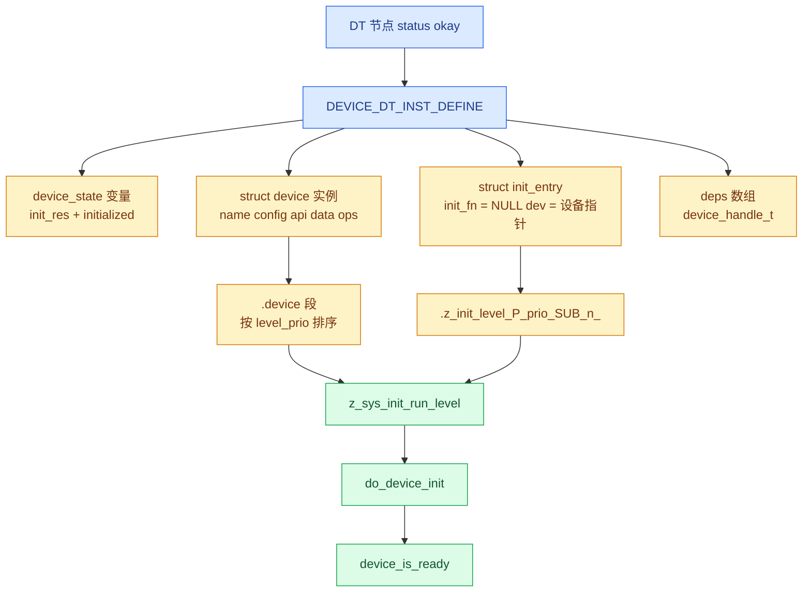
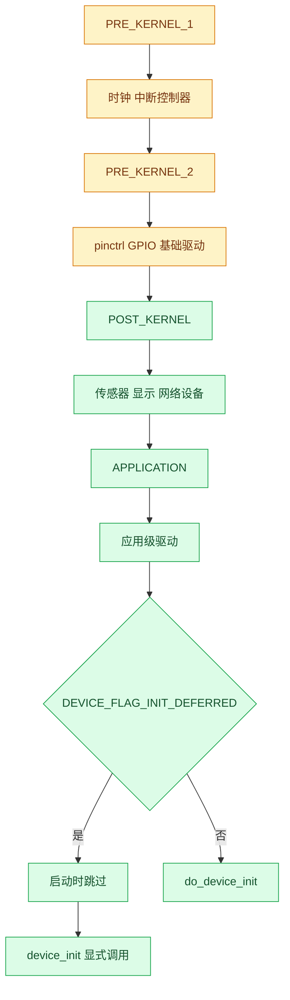

# Zephyr 源码详解 05：设备驱动模型

> 涉及文件：
> - `include/zephyr/device.h`（`struct device`、`DEVICE_DT_DEFINE`，1501 行）
> - `kernel/device.c`（运行时服务，277 行）
> - `kernel/init.c`（`z_sys_init_run_level` 调用 `do_device_init`）
> - `kernel/Kconfig.device`（设备初始化优先级）
> - `drivers/gpio/gpio_emul.c`（一个完整的驱动样例）
> - KB：`../../../05-学习笔记与知识库/Knowledge-Base/zephyr/device.md`

---

## 1. 一个设备对象由什么组成

### 1.1 `struct device`

`include/zephyr/device.h:543-590`：

```c
struct device {
	/** Name of the device instance */
	const char *name;
	/** Address of device instance config information */
	const void *config;
	/** Address of the API structure exposed by the device instance */
	const void *api;
	/** Address of the common device state */
	struct device_state *state;
	/** Address of the device instance private data */
	void *data;
	/** Device operations */
	struct device_ops ops;
	/** Device flags */
	device_flags_t flags;
#if defined(CONFIG_DEVICE_DEPS) || defined(__DOXYGEN__)
	/**
	 * Optional pointer to dependencies associated with the device.
	 *
	 * This encodes a sequence of sets of device handles that have some
	 * relationship to this node. The individual sets are extracted with
	 * dedicated API, such as device_required_handles_get(). Only available
	 * if @kconfig{CONFIG_DEVICE_DEPS} is enabled.
	 */
	Z_DEVICE_DEPS_CONST device_handle_t *deps;
#endif /* CONFIG_DEVICE_DEPS */
#if defined(CONFIG_PM_DEVICE) || defined(__DOXYGEN__)
	...
#endif
	...
};
```

| 字段 | 谁写 | 谁读 | 说明 |
|---|---|---|---|
| `name` | 编译期 | `device_get_binding()` | 字符串，链接进 ROM |
| `config` | 编译期 | 驱动自己 | 指向 `*_config` 常量结构 |
| `api` | 编译期 | 调用方 | 指向 `*_driver_api` 函数表 |
| `state` | 编译期 | `device_is_ready()` | 指向 RAM 中的 `device_state` |
| `data` | 编译期 | 驱动自己 | 指向 `*_data` 可变结构 |
| `ops.init` | 编译期 | `do_device_init()` | 设备初始化函数 |
| `ops.deinit` | 编译期 | `device_deinit()` | 可选 |
| `flags` | 编译期 | init 执行器 | 目前只有 `DEVICE_FLAG_INIT_DEFERRED` |
| `deps` | 编译期 | `device_required_foreach()` | 设备依赖句柄数组 |

**大小估算**：

| 平台 | 大小 | 计算 |
|---|---|---|
| 32 位 | ~40 B | 5×4 + 8(ops) + 1(flags)+3(pad) + 4(deps) + 4(pm) |
| 64 位 | ~80 B | 5×8 + 16(ops) + 1+7(pad) + 8(deps) + 8(pm) |

### 1.2 `device_state` 只有 2 个有效字段

`device.h:488-502`：

```c
struct device_state {
	/**
	 * Device initialization return code (positive errno value).
	 *
	 * Device initialization functions return a negative errno code if they
	 * fail. In Zephyr, errno values do not exceed 255, so we can store the
	 * positive result value in a uint8_t type.
	 */
	uint8_t init_res;

	/** Indicates the device initialization function has been
	 * invoked.
	 */
	bool initialized : 1;
};
```

`init_res` 存的是 **正数** errno。`do_device_init()` 在失败时把
`-ENODEV` 翻成 `ENODEV` 存进去，返回值再翻回负数
（`device.c:24-60`）：

```c
	if (dev->ops.init != NULL) {
		rc = dev->ops.init(dev);
		/* If initialization failed, record in dev->state->init_res
		 * the POSITIVE value of the resulting errno
		 */
		if (rc != 0) {
			/* device's init function should return:
			 *   0 on success
			 *   a negative value on failure (-errno)
			 * errno value maps to an uint8_t range as of now.
			 */
			__ASSERT(rc >= -UINT8_MAX && rc < 0, "device %s init: invalid error (%d)",
				 dev->name, rc);

			if (rc < 0) {
				rc = -rc;
			}
			/* handle error value overflow in production
			 * this is likely a bug in the device's init function. Signals it
			 */
			if (rc > UINT8_MAX) {
				rc = UINT8_MAX;
			}
			dev->state->init_res = rc;
		}
	}
```

随后函数把 `initialized` 置 true，并在末尾 `return -rc;`
（`device.c:126-137`）。

注意 `initialized = true` 在**失败时也设置**。所以
`device_is_ready()` 不能只看 `initialized`，还要看 `init_res == 0`
（`device.c:186-197`）：

```c
bool z_impl_device_is_ready(const struct device *dev)
{
	/*
	 * if an invalid device pointer is passed as argument, this call
	 * reports the `device` as not ready for usage.
	 */
	if (dev == NULL) {
		return false;
	}

	return dev->state->initialized && (dev->state->init_res == 0U);
}
```

**陷阱**：`device_is_ready()` 对"init 从未被调用"和"init 失败"
都返回 false，无法区分。要区分就查 `dev->state->init_res`。

---

## 2. `DEVICE_DT_DEFINE` 的展开链

### 2.1 四层宏

```
DEVICE_DT_INST_DEFINE(inst, ...)
  → DEVICE_DT_DEFINE(DT_DRV_INST(inst), ...)
    → DEVICE_DT_DEINIT_DEFINE(node_id, init_fn, NULL, ...)
      → Z_DEVICE_STATE_DEFINE(dev_id)
      → Z_DEVICE_DEFINE(node_id, dev_id, name, init_fn, deinit_fn, ...)
        → Z_DEVICE_DEPS_DEFINE(...)          (可选)
        → Z_DEVICE_DT_METADATA_DEFINE(...)   (可选)
        → Z_DEVICE_BASE_DEFINE(...)          → struct device 实例
        → Z_DEVICE_INIT_ENTRY_DEFINE(...)    → struct init_entry 实例
```

`device.h:265-268`：

```c
#define DEVICE_DT_DEFINE(node_id, init_fn, pm, data, config, level, prio, api, \
			 ...)                                                  \
	DEVICE_DT_DEINIT_DEFINE(node_id, init_fn, NULL, pm, data, config,      \
				level, prio, api, __VA_ARGS__)
```

`device.h:1378-1397`：

```c
#define Z_DEVICE_DEFINE(node_id, dev_id, name, init_fn, deinit_fn, flags, pm,   \
			data, config, level, prio, api, state, ...)             \
	Z_DEVICE_NAME_CHECK(name);                                              \
                                                                                \
	IF_ENABLED(CONFIG_DEVICE_DEPS,                                          \
		   (Z_DEVICE_DEPS_DEFINE(node_id, dev_id, __VA_ARGS__);))       \
                                                                                \
	IF_ENABLED(CONFIG_DEVICE_DT_METADATA,                                   \
		   (IF_ENABLED(DT_NODE_EXISTS(node_id),                         \
			      (Z_DEVICE_DT_METADATA_DEFINE(node_id, dev_id);))))\
                                                                                \
	Z_DEVICE_BASE_DEFINE(node_id, dev_id, name, init_fn, deinit_fn, flags,  \
			     pm, data, config, level, prio, api, state,         \
			     Z_DEVICE_DEPS_NAME(dev_id));                       \
                                                                                \
	Z_DEVICE_INIT_ENTRY_DEFINE(node_id, dev_id, level, prio);               \
                                                                                \
	IF_ENABLED(CONFIG_LLEXT,                                                \
		   (IF_ENABLED(DT_NODE_EXISTS(node_id),                         \
				(Z_DEVICE_EXPORT(node_id);))))
```

### 2.2 设备对象放进哪个 section

`device.h:1316-1324`：

```c
#define Z_DEVICE_BASE_DEFINE(node_id, dev_id, name, init_fn, deinit_fn, flags, pm, data, config,   \
			     level, prio, api, state, deps)                                        \
	IF_DISABLED(DT_NODE_EXISTS(node_id), (static))                                             \
	IF_DISABLED(Z_DEVICE_IS_MUTABLE(node_id), (const))                                         \
	STRUCT_SECTION_ITERABLE_NAMED_ALTERNATE(                                                   \
		device, COND_CODE_1(Z_DEVICE_IS_MUTABLE(node_id), (device_mutable), (device)),     \
		Z_DEVICE_SECTION_NAME(level, prio), DEVICE_NAME_GET(dev_id)) =                     \
		Z_DEVICE_INIT(name, init_fn, deinit_fn, flags, pm, data, config, api, state, deps, \
			      node_id, dev_id)
```

section 名来自 `device.h:1294-1295`：

```c
#define Z_DEVICE_SECTION_NAME(level, prio)                                     \
	_CONCAT(INIT_LEVEL_ORD(level), _##prio)
```

例如 `POST_KERNEL, 50` → `3_50`。设备对象按"level 序号 + 优先级"
排序，和 init entry 的排序规则一致。

### 2.3 init entry 只有一个 `dev` 指针

`device.h:1346-1354`：

```c
#define Z_DEVICE_INIT_ENTRY_DEFINE(node_id, dev_id, level, prio)                                   \
	Z_DEVICE_CHECK_INIT_LEVEL(level)                                                           \
                                                                                                   \
	static const Z_DECL_ALIGN(struct init_entry) __used __noasan Z_INIT_ENTRY_SECTION(         \
		level, prio, Z_DEVICE_INIT_SUB_PRIO(node_id))                                      \
		Z_INIT_ENTRY_NAME(DEVICE_NAME_GET(dev_id)) = {                                     \
			.init_fn = NULL,                                                           \
			.dev = (const struct device *)&DEVICE_NAME_GET(dev_id),                    \
		}
```

`init_fn = NULL`，`dev != NULL`。所以 `z_sys_init_run_level()`
看到 `dev != NULL` 就走 `do_device_init(dev)`，而不是直接调用函数。

`Z_DEVICE_CHECK_INIT_LEVEL()`（`device.h:1331-1335`）限制设备只能用
`PRE_KERNEL_1`、`PRE_KERNEL_2`、`POST_KERNEL` 三个 level。
设备不能用 `EARLY`（arch 还没准备好）或 `APPLICATION`（太晚）。

### 2.4 展开后的内存布局



---

## 3. 一个真实驱动长什么样

以 `drivers/gpio/gpio_emul.c` 为例（GPIO 模拟器，不依赖硬件）。

### 3.1 API 表

`gpio_emul.c:840-856`：

```c
static DEVICE_API(gpio, gpio_emul_driver) = {
	.pin_configure = gpio_emul_pin_configure,
#ifdef CONFIG_GPIO_GET_CONFIG
	.pin_get_config = gpio_emul_pin_get_config,
#endif
	.port_get_raw = gpio_emul_port_get_raw,
	.port_set_masked_raw = gpio_emul_port_set_masked_raw,
	.port_set_bits_raw = gpio_emul_port_set_bits_raw,
	.port_clear_bits_raw = gpio_emul_port_clear_bits_raw,
	.port_toggle_bits = gpio_emul_port_toggle_bits,
	.pin_interrupt_configure = gpio_emul_pin_interrupt_configure,
	.manage_callback = gpio_emul_manage_callback,
	.get_pending_int = gpio_emul_get_pending_int,
#ifdef CONFIG_GPIO_GET_DIRECTION
	.port_get_direction = gpio_emul_port_get_direction,
#endif /* CONFIG_GPIO_GET_DIRECTION */
};
```

`DEVICE_API(gpio, name)` 展开为：

```c
const STRUCT_SECTION_ITERABLE(gpio_driver_api, name)
```

（`device.h:1432`）。也就是说 **API 表本身也放在一个 iterable section**，
可以被遍历（用于生成文档、做 API 兼容性检查）。

### 3.2 初始化函数

`gpio_emul.c:858-865`：

```c
static int gpio_emul_init(const struct device *dev)
{
	struct gpio_emul_data *drv_data =
		(struct gpio_emul_data *)dev->data;

	sys_slist_init(&drv_data->callbacks);
	return 0;
}
```

所有驱动 init 的签名都是 `int (*)(const struct device *dev)`。
约定：

- 返回 0 成功；
- 返回负 errno 失败（只能 -1 ~ -255）；
- 失败后 `device_is_ready()` 返回 false，但设备对象仍存在。

### 3.3 实例化

`gpio_emul.c:913-918`：

```c
	DEVICE_DT_INST_DEFINE(_num, gpio_emul_init,			\
			    PM_DEVICE_DT_INST_GET(_num),		\
			    &gpio_emul_data_##_num,			\
			    &gpio_emul_config_##_num, POST_KERNEL,	\
			    CONFIG_GPIO_INIT_PRIORITY,			\
			    &gpio_emul_driver);
```

参数顺序（对应 `DEVICE_DT_DEFINE`）：

| 位置 | 值 | 含义 |
|---|---|---|
| 1 | `_num` | DT 实例号 |
| 2 | `gpio_emul_init` | init 函数 |
| 3 | `PM_DEVICE_DT_INST_GET(_num)` | PM 资源（可为 NULL） |
| 4 | `&gpio_emul_data_##_num` | 可变数据 |
| 5 | `&gpio_emul_config_##_num` | 常量配置 |
| 6 | `POST_KERNEL` | init level |
| 7 | `CONFIG_GPIO_INIT_PRIORITY` | 优先级 |
| 8 | `&gpio_emul_driver` | API 表 |

注意第 6 个参数：GPIO 驱动用 `POST_KERNEL`，因为它的 `pin_configure`
可能调用 pinctrl，而 pinctrl 在 `PRE_KERNEL_2`。

### 3.4 调用方怎么用 API

驱动框架的头文件（如 `include/zephyr/drivers/gpio.h`）会提供
内联包装：先做 `port->api` 空指针检查，再转调函数表里的
`pin_configure`。调用链如下：


---

## 4. 初始化顺序与依赖

### 4.1 排序规则

设备 init 顺序由三元组决定：

```
(level, prio, sub_prio)
```

- `level`：`PRE_KERNEL_1` < `PRE_KERNEL_2` < `POST_KERNEL`；
- `prio`：同 level 内数字小的先执行；
- `sub_prio`：由 DT 依赖自动计算（`Z_DEVICE_INIT_SUB_PRIO`），
  保证"被依赖的设备先初始化"。

### 4.2 依赖从哪来

`CONFIG_DEVICE_DEPS=y` 时，构建脚本扫描每个设备的
`devicetree` 属性（`io-channels`、`clocks`、`gpios`、`parent` 等），
生成 `deps` 数组。`device_required_foreach()`（`device.c:257-265`）
可以遍历：

```c
int device_required_foreach(const struct device *dev,
			    device_visitor_callback_t visitor_cb,
			    void *context)
{
	size_t handle_count = 0;
	const device_handle_t *handles = device_required_handles_get(dev, &handle_count);

	return device_visitor(handles, handle_count, visitor_cb, context);
}
```

### 4.3 延迟初始化

`DEVICE_FLAG_INIT_DEFERRED`（`device.h:526`）的设备在启动时被跳过
（`init.c:235-237`）：

```c
		if ((dev->flags & DEVICE_FLAG_INIT_DEFERRED) == 0U) {
			result = do_device_init(dev);
		}
```

之后由 `device_init(dev)` 显式触发（`device.c:63-70`）：

```c
int z_impl_device_init(const struct device *dev)
{
	if (dev->state->initialized) {
		return -EALREADY;
	}

	return do_device_init(dev);
}
```

典型场景：USB、SD 卡这类"插入后才存在"的设备。

### 4.4 初始化时序



---

## 5. 设备查找

### 5.1 编译期：`DEVICE_DT_GET`

`device.h:323`：

```c
#define DEVICE_DT_GET(node_id) (&DEVICE_DT_NAME_GET(node_id))
```

它直接用 `&` 取全局变量地址，**零运行时开销**。
如果该节点没有对应设备，链接时报：

```
undefined reference to `__device_dts_ord_123'
```

这是 Zephyr 新手最常见的错误之一，原因通常是：

1. 驱动没编译（Kconfig 没开）；
2. DT 节点 `status = "disabled"`；
3. 驱动的 `DT_DRV_COMPAT` 与 binding 的 `compatible` 不匹配。

### 5.2 运行期：`device_get_binding`

`device.c:92-97`：

```c
	/* Return NULL if the device matching 'name' is not ready. */
	STRUCT_SECTION_FOREACH(device, dev) {
		if ((dev->name == name) || (strcmp(name, dev->name) == 0)) {
			return z_impl_device_is_ready(dev) ? dev : NULL;
		}
	}
```

复杂度 O(设备总数)，每个设备一次 `strcmp`。设备多时会慢，
新代码应优先用 `DEVICE_DT_GET()`。

## 6. 设备句柄：为什么不用指针

`device_handle_t` 是 `uintptr_t`，编码方式（`device.h:600-613`）：

```c
static inline device_handle_t device_handle_get(const struct device *dev)
{
	device_handle_t ret = DEVICE_HANDLE_NULL;
	STRUCT_SECTION_START_EXTERN(device);

	/* TODO: If/when devices can be constructed that are not part of the
	 * fixed sequence we'll need another solution.
	 */
	if (dev != NULL) {
		ret = 1 + (device_handle_t)(dev - STRUCT_SECTION_START(device));
	}

	return ret;
}
```

句柄 = "设备在 `.device` section 里的下标 + 1"，0 表示 NULL。
好处：

- 32 位系统里句柄 4 B，和指针一样，但**可序列化**；
- 设备表可以放在 ROM，句柄在运行时仍有效；
- 支持 `CONFIG_DEVICE_DEPS_DYNAMIC`（运行期改写 deps）。

代价：句柄只在"设备表不变"的前提下有效，动态加载
（`CONFIG_LLEXT`）时要特别小心。

---

## 7. 量化与陷阱

### 7.1 一个设备的 ROM/RAM 开销

以 `gpio_emul` 一个实例为例（32 位）：

| 项目 | ROM | RAM | 说明 |
|---|---|---|---|
| `struct device` | 40 B | 0 | 放 `.device` section |
| `struct device_state` | 0 | 2 B（对齐后 4 B） | 1 B init_res + 1 bit |
| `init_entry` | 8 B | 0 | 两个指针 |
| config 结构 | ~20 B | 0 | 引脚数、中断能力 |
| data 结构 | 0 | ~40 B | 回调链表、flags |
| API 表 | ~40 B | 0 | 10 个函数指针 |
| **合计** | **~108 B** | **~44 B** | 不含栈与堆 |

100 个设备的板子，光设备对象就占 ~10 KB ROM + ~4 KB RAM。
这是 Zephyr 镜像比裸机大的主要原因之一。

### 7.2 陷阱清单

1. **`device_is_ready()` 返回 false 不代表设备不存在**。
   init 失败也会 false，此时 `device_get_binding()` 也返回 NULL。
2. **`DEVICE_DT_DEFINE` 的 `prio` 必须是字面量或宏**。
   `CONFIG_X + 5` 这种表达式会让 section 名字变成
   `3_45` 之类无法排序的字符串，链接脚本行为未定义。
3. **同一个 compatible 多个节点**：`DEVICE_DT_GET_ANY(compat)`
   只返回其中一个，且不保证顺序。
4. **`dev->api` 可能是 NULL**（`DEVICE_DEFINE` 允许 `api=NULL`）。
   所有 `*_driver_api` 包装都应先判空再调用。
5. **init 函数返回 `-1` 会被断言拦截**。`do_device_init()` 要求
   `rc >= -UINT8_MAX && rc < 0`，`-1` 是合法的，但 `-1000` 会
   `__ASSERT` 失败（debug build）。

---

## 8. 读码路径

```
device.h:488        device_state
device.h:543        struct device
device.h:600        device_handle_get
device.h:1316       Z_DEVICE_BASE_DEFINE
device.h:1346       Z_DEVICE_INIT_ENTRY_DEFINE
device.h:1378       Z_DEVICE_DEFINE
device.h:1432       DEVICE_API
kernel/device.c:18  do_device_init
kernel/device.c:186 device_is_ready
kernel/init.c:213   z_sys_init_run_level
drivers/gpio/gpio_emul.c:840  API 表样例
drivers/gpio/gpio_emul.c:913  实例化样例
```

> 下一篇：`06-中断与异常.md`，看中断如何从向量表走到 ISR 再回到调度器。
