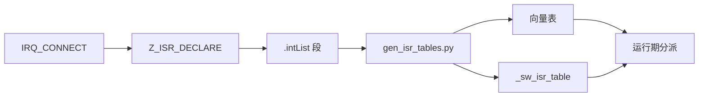
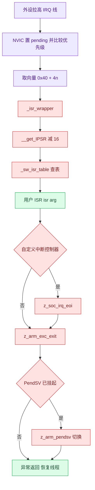
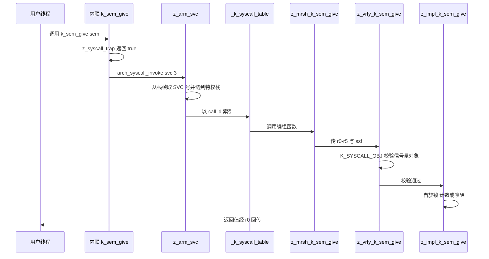

# Zephyr 源码详解 06：中断、异常与系统调用

> 涉及文件：
> - `arch/arm/core/cortex_m/vector_table.S`（向量表，96 行）
> - `arch/arm/core/cortex_m/isr_wrapper.c`（`_isr_wrapper`，98 行）
> - `arch/arm/core/cortex_m/irq_manage.c`（NVIC 与动态中断，304 行）
> - `arch/arm/core/cortex_m/svc.S`（SVC 入口，483 行）
> - `arch/arm/core/userspace.S`（`z_arm_do_syscall` 与 `_k_syscall_table`）
> - `include/zephyr/sw_isr_table.h`（软中断表，317 行）
> - `include/zephyr/irq.h`（`IRQ_CONNECT`/`ISR_DIRECT_DECLARE`）
> - `include/zephyr/arch/arm/irq.h`（ARM 宏展开）
> - `kernel/irq_offload.c`（ISR 上下文执行，23 行）
> - KB：`../../../05-学习笔记与知识库/Knowledge-Base/zephyr/irq.md`

---

## 1. Cortex-M 的异常模型

Cortex-M 把"中断"和"异常"统一编号：

| 编号 | 异常 | 向量表偏移 | Zephyr 处理 |
|---|---|---|---|
| 0 | 初始 MSP | 0x00 | `z_main_stack + CONFIG_MAIN_STACK_SIZE` |
| 1 | Reset | 0x04 | `z_arm_reset` |
| 2 | NMI | 0x08 | `z_arm_nmi` |
| 3 | HardFault | 0x0C | `z_arm_hard_fault` |
| 4 | MemManage | 0x10 | `z_arm_mpu_fault` |
| 5 | BusFault | 0x14 | `z_arm_bus_fault` |
| 6 | UsageFault | 0x18 | `z_arm_usage_fault` |
| 7~10 | 保留 | 0x1C~0x28 | 0 |
| 11 | SVCall | 0x2C | `z_arm_svc` |
| 12 | DebugMonitor | 0x30 | `z_arm_debug_monitor` |
| 13 | 保留 | 0x34 | 0 |
| 14 | PendSV | 0x38 | `z_arm_pendsv` 或 `z_arm_exc_spurious` |
| 15 | SysTick | 0x3C | `sys_clock_isr` |
| 16+ | 外部 IRQ | 0x40+4n | `_isr_wrapper` |

`vector_table.S:42-96` 逐个 `.word` 填充：

```asm
    .word z_arm_reset
    .word z_arm_nmi

    .word z_arm_hard_fault
#if defined(CONFIG_ARMV6_M_ARMV8_M_BASELINE)
    .word 0
    ...
#elif defined(CONFIG_ARMV7_M_ARMV8_M_MAINLINE)
    .word z_arm_mpu_fault
    .word z_arm_bus_fault
    .word z_arm_usage_fault
...
    .word z_arm_svc
    .word z_arm_debug_monitor
...
    .word 0
#if defined(CONFIG_MULTITHREADING) && !defined(CONFIG_USE_SWITCH)
    .word z_arm_pendsv
#else
    .word z_arm_exc_spurious
#endif
```

前 16 个向量（64 B）是"系统异常"，从第 17 个开始是外部中断。
外部中断的向量**不直接指向用户 ISR**，而是统一指向 `_isr_wrapper`。
这是 Zephyr 能在运行时 `irq_connect_dynamic()` 的关键。

---

## 2. 从外部中断到用户 ISR

### 2.1 `_isr_wrapper` 做的事

`isr_wrapper.c:33-98`：

```c
void _isr_wrapper(void)
{
#ifdef CONFIG_TRACING_ISR
	sys_trace_isr_enter();
#endif /* CONFIG_TRACING_ISR */

#ifdef CONFIG_PM
	/*
	 * All non-ZLI interrupts are disabled when handling idle wakeup. ...
	 */
	unsigned int key = arch_irq_lock();

	/* is this a wakeup from idle ? */
	/* requested idle duration, in ticks */
	if (_kernel.idle != 0) {
		/* clear kernel idle state */
		_kernel.idle = 0;
		pm_system_resume();
	}
	/* re-enable interrupts */
	arch_irq_unlock(key);
#endif /* CONFIG_PM */

#if defined(CONFIG_ARM_CUSTOM_INTERRUPT_CONTROLLER)
	int32_t irq_number = z_soc_irq_get_active();
#else
	int32_t irq_number = __get_IPSR();
#endif
	/* _sw_isr_table does not map the core system exceptions,
	 * which take first 16 interrupt numbers, only the external
	 * interrupts.
	 */
	irq_number -= 16;

#if defined(CONFIG_GEN_SW_ISR_TABLE_ARRAY)
	const struct _isr_table_entry *entry = &_sw_isr_table[irq_number];
	(entry->isr)(entry->arg);
#elif defined(CONFIG_GEN_SW_ISR_TABLE_SWITCH)
	struct _isr_table_entry entry;

	get_isr_entry(irq_number, &entry);
	(entry.isr)(entry.arg);
#endif /* CONFIG_GEN_SW_ISR_TABLE_ARRAY */

#if defined(CONFIG_ARM_CUSTOM_INTERRUPT_CONTROLLER)
	z_soc_irq_eoi(irq_number);
#endif

#ifdef CONFIG_TRACING_ISR
	sys_trace_isr_exit();
#endif /* CONFIG_TRACING_ISR */

	z_arm_exc_exit();
}
```

四步：

1. **`__get_IPSR()` 取当前异常号**，减 16 得到外部 IRQ 号；
2. **查 `_sw_isr_table`** 得到 `{arg, isr}`；
3. **调用 `isr(arg)`**；
4. **`z_arm_exc_exit()`**：处理 PendSV、决定是否切换。

### 2.2 软中断表项

`sw_isr_table.h:34-42`：

```c
/*
 * Note the order: arg first, then ISR. This allows a table entry to be
 * loaded arg -> r0, isr -> r3 in _isr_wrapper with one ldmia instruction,
 * on ARM Cortex-M (Thumb2).
 */
struct _isr_table_entry {
	const void *arg;
	void (*isr)(const void *);
};
```

字段顺序是**性能设计**：`ldmia` 一条指令同时装载 `arg` 和 `isr`。
32 位下每项 8 B，100 个 IRQ 的表 = 800 B ROM（`CONFIG_DYNAMIC_INTERRUPTS=n`
时）或 800 B RAM（动态时）。

### 2.3 `IRQ_CONNECT` 只写 `.intList`

`include/zephyr/arch/arm/irq.h:180-187`：

```c
#define ARCH_IRQ_CONNECT(irq_p, priority_p, isr_p, isr_param_p, flags_p) \
{ \
	BUILD_ASSERT(!(flags_p & IRQ_ZERO_LATENCY), \
			"ZLI interrupts must be registered using IRQ_DIRECT_CONNECT()"); \
	_CHECK_PRIO(priority_p, flags_p) \
	Z_ISR_DECLARE(irq_p, 0, isr_p, isr_param_p); \
	z_arm_irq_priority_set(irq_p, priority_p, flags_p); \
}
```

`Z_ISR_DECLARE`（`sw_isr_table.h:286-289`）：

```c
#define Z_ISR_DECLARE(irq, flags, func, param) \
	static Z_DECL_ALIGN(struct _isr_list) Z_GENERIC_SECTION(.intList) \
		__used _MK_ISR_NAME(func, __COUNTER__) = \
			{irq, flags, (void *)&func, (const void *)param}
```

它在 `.intList` 段里放一条记录。构建时 `gen_isr_tables.py` 扫描这个段：



所以 `IRQ_CONNECT` 的第二段（`z_arm_irq_priority_set`）是**运行时**
设置 NVIC 优先级，第一段是**链接期**生成表项。两者必须都成功。

### 2.4 动态中断

`CONFIG_DYNAMIC_INTERRUPTS=y` 时可以在运行时改 ISR：

```c
int arch_irq_connect_dynamic(unsigned int irq, unsigned int priority,
			     void (*routine)(const void *parameter), const void *parameter,
			     uint32_t flags)
{
	z_isr_install(irq, routine, parameter);
	z_arm_irq_priority_set(irq, priority, flags);
	return irq;
}
```

（`irq_manage.c:266-273`）此时 `_sw_isr_table` 必须在 RAM，
表项可写。代价是 8 B × IRQ 数 的 RAM。

---

## 3. 直接中断：绕过 `_isr_wrapper`

### 3.1 适用场景

`irq.h:137-157` 列出 direct ISR 的限制：

| 限制 | 含义 |
|---|---|
| 无参数 | ISR 签名是 `int name(void)` |
| 不切栈 | 跑在被中断线程的栈上（除非硬件自动切） |
| 中断锁状态不变 | 进入时如果中断是关的，保持关 |
| 调度可选 | 返回值决定是否调用 `z_arm_int_exit()` |
| PM 可选 | 需要手动放 `ISR_DIRECT_PM()` |

### 3.2 `ISR_DIRECT_DECLARE` 的展开

`include/zephyr/arch/arm/irq.h:241-249`：

```c
#define ARCH_ISR_DIRECT_DECLARE(name) \
	static inline int name##_body(void); \
	ARCH_ISR_DIAG_OFF \
	__attribute__ ((interrupt ("IRQ"))) void name(void) \
	{ \
		int check_reschedule; \
		ISR_DIRECT_HEADER(); \
		check_reschedule = name##_body(); \
		ISR_DIRECT_FOOTER(check_reschedule); \
```

使用时：

```c
ISR_DIRECT_DECLARE(my_isr)
{
	bool done = do_stuff();
	ISR_DIRECT_PM(); /* 可选 */
	if (!done) {
		return 0; /* 不检查是否要 z_swap */
	}
	k_sem_give(some_sem);
	return 1; /* 允许调度 */
}
```

`__attribute__((interrupt("IRQ")))` 让编译器生成"异常入口/出口"
代码（保存 caller-saved 寄存器、`bx lr` 返回）。`ISR_DIRECT_HEADER()`
在 ARM 上只做 tracing（`irq.h:213-218`），`ISR_DIRECT_FOOTER(swap)`
在 `swap != 0` 时调用 `z_arm_int_exit()`（`irq.h:220-228`）。

### 3.3 零延迟中断

`IRQ_ZERO_LATENCY`（`arch/arm/irq.h:150`）的中断**不受 `irq_lock()` 影响**，
因此必须用 `IRQ_DIRECT_CONNECT` 注册（`ARCH_IRQ_CONNECT` 里有
`BUILD_ASSERT(!(flags_p & IRQ_ZERO_LATENCY))`）。

用途：电机控制、PLS 采样这类"晚一个周期就废"的中断。
代价：ISR 里不能调用任何内核 API（调度器可能处于不一致状态），
且不能使用 `ISR_DIRECT_PM()`。

---

## 4. 中断路径全景



### 4.1 嵌套中断

Cortex-M 硬件自动处理嵌套：高优先级中断可以打断低优先级 ISR。
Zephyr 额外维护 `_kernel.cpus[i].nested` 计数：

- `nested == 0` 时退出才做调度决策；
- `nested > 0` 时只恢复被中断的 ISR。

这就是 `z_arm_exc_exit()` 里"只在最外层决定是否 `z_swap`"的原因。

### 4.2 中断栈

`CONFIG_ISR_STACK_SIZE` 默认 2048 B（`kernel/Kconfig:166`）。
Cortex-M 上中断使用 MSP，线程使用 PSP：

```
线程模式 + PSP → 线程栈
Handler 模式 + MSP → 中断栈（z_interrupt_stacks[cpu]）
```

`z_init_cpu()`（`init.c:395-402`）把 `irq_stack` 设为
`z_interrupt_stacks[id]` 的**顶部**（起始地址 + 大小）。

---

## 5. 系统调用：用户态到内核态

### 5.1 一个 `__syscall` 声明生成什么

头文件里只写一行（`include/zephyr/kernel.h:786`）：

```c
__syscall void k_yield(void);
```

`scripts/build/parse_syscalls.py` 扫描所有头文件，把
`__syscall` 声明提取成 JSON；`gen_syscalls.py` 再生成：

| 产物 | 内容 |
|---|---|
| `zephyr/syscall_list.h` | `K_SYSCALL_K_YIELD` 等 ID |
| `zephyr/syscalls/k_yield_mrsh.c` | `z_mrsh_k_yield()` 编组函数 |
| 调用方内联函数 | 用户态走 `arch_syscall_invoke*`，内核态直接调 `z_impl_*` |
| `_k_syscall_table` | ID → `z_mrsh_*` 的数组 |

`gen_syscalls.py:8-22` 的 docstring 写得很清楚：

```python
"""
Script to generate system call invocation macros

This script parses the system call metadata JSON file emitted by
parse_syscalls.py to create several files:

- A file containing weak aliases of any potentially unimplemented system calls,
  as well as the system call dispatch table, which maps system call type IDs
  to their handler functions.

- A header file defining the system call type IDs, as well as function
  prototypes for all system call handler functions.

- A directory containing header files. Each header corresponds to a header
  that was identified as containing system call declarations. These
  generated headers contain the inline invocation functions for each system
  call in that header.
"""
```

### 5.2 命名约定

`include/zephyr/syscall.h:37-47`：

```c
 * All system calls require a verifier function and an implementation
 * function.  These must follow a naming convention. For a system call
 * named k_foo():
 *
 * - The handler function will be named z_vrfy_k_foo(). Handler
 *   functions have the same type signature as the wrapped call,
 *   verify arguments passed up from userspace, and call the
 *   implementation function. See documentation for that typedef for
 *   more information.  - The implementation function will be named
 *   z_impl_k_foo(). This is the actual implementation of the system
 *   call.
```

三层：

```
用户调用 k_foo()
  → 内联函数 z_syscall_trap() 判断是否陷出
    → 用户态：arch_syscall_invokeN(...) → svc → _k_syscall_table[id]
      → z_mrsh_k_foo()  编组参数、取 ssf
        → z_vrfy_k_foo() 校验对象/内存
          → z_impl_k_foo() 真正实现
    → 内核态：直接 z_impl_k_foo()
```

### 5.3 ARM 的 SVC 入口

`arch/arm/core/cortex_m/svc.S:33-42` 的注释：

```asm
 * @brief Service call handler
 *
 * The service call (svc) is used in the following occasions:
 * - IRQ offloading
 * - Kernel run-time exceptions
 * - System Calls (User mode)
 *
```

SVC 号约定（`svc.S:75-80`）：

```asm
   /*
    * grab service call number:
    * 0: Unused
    * 1: irq_offload (if configured)
    * 2: kernel panic or oops (software generated fatal exception)
    * 3: System call (if user mode supported)
    */
```

### 5.4 分发表

`arch/arm/core/userspace.S:388-399`：

```asm
dispatch_syscall:
    ldr ip, =_k_syscall_table
    lsl r6, #2
    add ip, r6
    ldr ip, [ip]	/* load table address */

    /* execute function from dispatch table */
    blx ip

    /* restore LR */
    ldr lr, [sp,#16]
```

`_k_syscall_table` 是 `uintptr_t[]`，索引 = call ID，每项 4 B。
100 个系统调用 = 400 B ROM。

### 5.5 系统调用时序



### 5.6 参数编组

`include/zephyr/arch/arm/syscall.h:66-71`（以 5 参数为例）：

```c
	register uint32_t ret __asm__("r0") = arg1;
	register uint32_t r1 __asm__("r1") = arg2;
	register uint32_t r2 __asm__("r2") = arg3;
	register uint32_t r3 __asm__("r3") = arg4;
	register uint32_t r4 __asm__("r4") = arg5;
	register uint32_t r6 __asm__("r6") = call_id;
```

约定：

- `r0~r5` 传 6 个参数；
- `r6` 传 call ID；
- 返回值在 `r0`；
- 超过 6 个参数时，第 7 个起打包进一个结构体，指针放 `r5`，
  由 `ssf`（syscall stack frame）配合校验。

---

## 6. 异常与故障

### 6.1 故障处理链

```
HardFault / BusFault / UsageFault / MemManage
  → z_arm_fault()            (arch/arm/core/cortex_m/fault.c)
    → z_arm_fatal_error(reason, esf)
      → k_fatal_halt / 用户注册的 fatal handler
```

`struct arch_esf`（exception stack frame）由硬件压栈的
`r0-r3, r12, lr, pc, xPSR` 加软件保存的 `r4-r11` 组成。
Zephyr 的 fault handler 会打印：

```
E: ***** HARD FAULT *****
E:   Fault escalation (see below)
E: r0/a1:  0x00000000  r1/a2:  0x20001234 ...
E: pc:     0x00001234  lr:    0x00005678
```

要解析这些寄存器，必须知道 `CONFIG_ARM_CORTEX_M_CPU` 对应的
`_EXC_RETURN` 状态（MSP/PSP、是否带 FPU 扩展帧）。

### 6.2 `k_sys_fatal_error_handler`

应用可以注册：

```c
void k_sys_fatal_error_handler(unsigned int reason, const struct arch_esf *esf)
{
	/* 记录现场、复位、或长眠 */
}
```

返回则走默认 `k_fatal_halt()`（死循环 + 关中断）。
`CONFIG_RESET_ON_FATAL_ERROR=y` 时改为复位。

---

## 7. 量化与陷阱

### 7.1 中断延迟分解（Cortex-M3/M4，72 MHz）

| 阶段 | 周期 | 说明 |
|---|---|---|
| 硬件异常进入 | 12 | 压栈 8 个寄存器 |
| `_isr_wrapper` 取 IPSR | ~6 | `MRS` + 减法 |
| 查表 + 间接调用 | ~8 | 两次 load + `blx` |
| 用户 ISR 之前 | **~26 周期 ≈ 0.36 µs** | 不含 ISR 本身 |
| `z_arm_exc_exit` | ~10~30 | 取决于是否 PendSV |
| 硬件异常返回 | 12 | 弹栈 |

`CONFIG_ZERO_LATENCY_IRQS=y` 的 direct ISR 可省掉 `_isr_wrapper`
的 ~14 周期，但只能用于不调用内核 API 的场景。

### 7.2 陷阱清单

1. **`IRQ_CONNECT` 的 `irq_p` 是"外部 IRQ 号"**，不是异常号。
   `IRQ_CONNECT(0, ...)` 对应向量表第 16 项。
2. **`_sw_isr_table` 不包含系统异常**。给 SysTick 写
   `IRQ_CONNECT(15, ...)` 是错的，SysTick 由
   `CONFIG_CORTEX_M_SYSTICK_INSTALL_ISR` 单独安装。
3. **`ISR_DIRECT_DECLARE` 的返回值必须是 0 或 1**。
   返回其他值在 `ISR_DIRECT_FOOTER()` 里被当作 bool，
   非 0 就调用 `z_arm_int_exit()`。
4. **ZLI 中断里不能 `k_sem_give()`**。调度器可能正持有锁，
   而 ZLI 不受 `irq_lock()` 保护。官方要求 ZLI ISR 返回 0。
5. **`irq_offload()` 会拿信号量**。`CONFIG_IRQ_OFFLOAD_NESTED=n` 时，
   `kernel/irq_offload.c:14-23` 在 `arch_irq_offload()` 前后分别
   `k_sem_take(&offload_sem, K_FOREVER)` / `k_sem_give()`。
   在 ISR 里调用且未开 NESTED 时，`k_sem_take(K_FOREVER)` 会
   panic（`sched.c:543`）。
6. **系统调用参数里的指针必须校验**。`z_vrfy_*` 里忘了
   `K_SYSCALL_MEMORY_READ/WRITE` 就是内核任意地址读写漏洞。

---

## 8. 读码路径

```
vector_table.S:40        向量表
isr_wrapper.c:33         _isr_wrapper
sw_isr_table.h:39        _isr_table_entry
sw_isr_table.h:286       Z_ISR_DECLARE
irq.h:50                 IRQ_CONNECT
arch/arm/irq.h:180       ARCH_IRQ_CONNECT
arch/arm/irq.h:241       ARCH_ISR_DIRECT_DECLARE
irq_manage.c:266         arch_irq_connect_dynamic
svc.S:33                 z_arm_svc
userspace.S:320          z_arm_do_syscall
userspace.S:388          _k_syscall_table 查表
parse_syscalls.py:1      __syscall 扫描
gen_syscalls.py:1        编组代码生成
```

> 下一篇：`07-构建系统与移植.md`，看 CMake/Kconfig/DT 如何把这一切编译出来。
