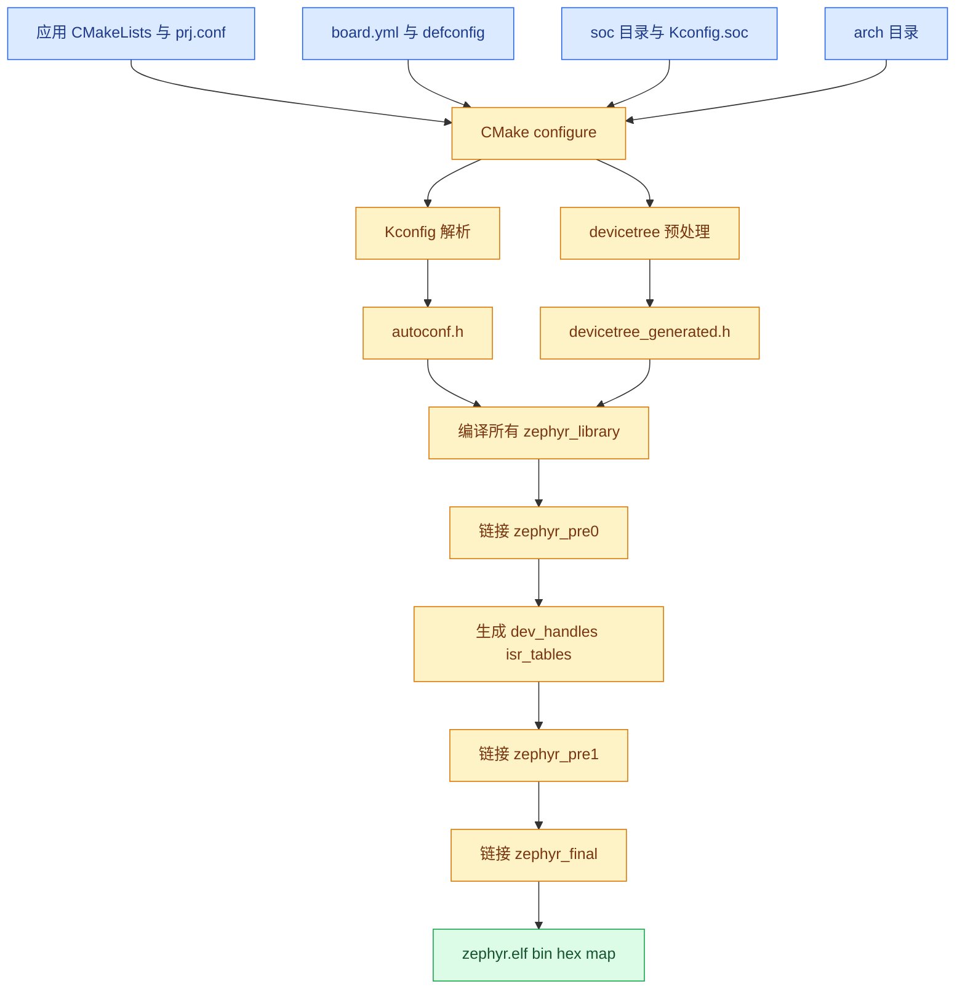
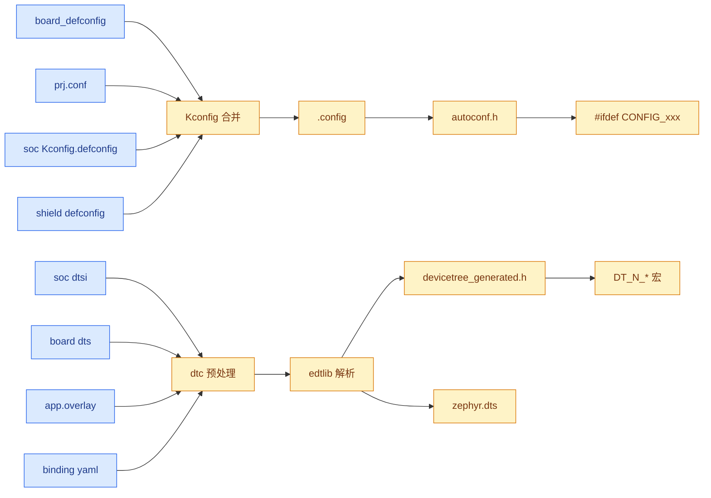

# Zephyr 源码详解 07：构建系统与移植

> 涉及文件：
> - `CMakeLists.txt`（Zephyr 构建入口，不是应用顶层）
> - `cmake/modules/kernel.cmake`、`dts.cmake`、`kconfig.cmake`、`boards.cmake`
> - `Kconfig.zephyr`、`Kconfig`（根菜单）
> - `west.yml`（manifest）
> - `boards/nordic/nrf52840dk/`（一个完整板级目录）
> - `soc/nordic/nrf52/`（SoC 层）
> - `arch/arm/`（架构层）
> - KB：`../../../05-学习笔记与知识库/Knowledge-Base/zephyr/sys_init.md`（初始化部分）

---

## 1. 三件套：CMake + Kconfig + devicetree

Zephyr 的构建系统不是"一个 Makefile"，而是三个独立系统在
CMake 的编排下协作：

| 系统 | 回答的问题 | 输入 | 输出 |
|---|---|---|---|
| CMake | 编译哪些文件、链接顺序 | `CMakeLists.txt`、`prj.conf`、board | `build.ninja` / Makefile |
| Kconfig | 编译哪些功能、参数多大 | `Kconfig*`、`*_defconfig`、`prj.conf` | `.config` → `autoconf.h` |
| devicetree | 硬件长什么样 | `.dts/.dtsi`、binding `yaml` | `devicetree_generated.h`、`zephyr.dts` |

三者的汇合点在 `cmake/modules/dts.cmake:10-30` 的注释里：

```cmake
# This module makes information from the devicetree available to
# various build stages, as well as to other arbitrary Python scripts:
#
#   - To Zephyr and application source code files, as a C macro API
#     defined in <zephyr/devicetree.h>
#
#   - To other arbitrary Python scripts (like twister) using a
#     serialized edtlib.EDT object in Python's pickle format
#     (https://docs.python.org/3/library/pickle.html)
#
#   - To users as a final devicetree source (DTS) file which can
#     be used for debugging
#
#   - To CMake files, after this module has finished running, using
#     devicetree extensions defined in cmake/modules/extensions.cmake
#
#   - To Kconfig files, both using some Kconfig symbols we generate
#     here as well as the extension functions defined in
#     scripts/kconfig/kconfigfunctions.py
```

---

## 2. 构建流水线



### 2.1 为什么最多要链接三次

`CMakeLists.txt:45-66`：

```cmake
# Currently up to three linking stages may be executed:
# zephyr_pre0:  First linking stage
# zephyr_pre1:  Second linking stage
# zephyr_final: Final linking stage
#
# There will at minimum be a single linking stage.
# When only a single linking stage is required, the `zephyr_pre0` will be mapped
# into the `zephyr_final` target.
#
# Multiple linking stages are required in the following cases:
# - device dependencies structs must be generated (CONFIG_DEVICE_DEPS=y)
# - ISR tables must be generated (CONFIG_GEN_ISR_TABLES=y)
# - Kernel objects hash tables (CONFIG_USERSPACE=y)
# - Application memory partitions (CONFIG_USERSPACE=y)
#
# Some generators require that memory locations has been fixed, thus those are
# placed at the second linking stage.
#
# When all three linking stages are active, then the following properties applies:
# - zephyr_pre0:  linker sections may resize / addresses may relocate
# - zephyr_pre1:  All linker section sizes are fixed, addresses cannot change
# - zephyr_final: Final image.
```

原因：`gen_isr_tables.py`、`gen_device_deps.py`、`gen_kobject_list.py`
需要知道**符号的最终地址**。但它们的输出（`isr_tables.c`、
`dev_handles.c`）又会改变镜像大小，所以只能"先链接一次拿到地址，
生成源码，再链接一次"。`pre1` 固定地址，`final` 产出最终镜像。

| 配置 | 链接次数 | 中间产物 |
|---|---|---|
| 最小 `hello_world` | 1 | 无 |
| `CONFIG_DEVICE_DEPS=y` | 2 | `dev_handles.c` |
| `CONFIG_GEN_ISR_TABLES=y` | 2 | `isr_tables.c` |
| `CONFIG_USERSPACE=y` | 3 | `kobject_hash.c`、`dev_handles.c` |

### 2.2 配置阶段的顺序

```
west build
  → cmake -B build -S samples/xxx
    → find_package(Zephyr)              (share/zephyr-package/cmake)
      → cmake/modules/root.cmake
        → boards.cmake   (选 board，解析 board.yml)
        → pre_dt.cmake   (收集 dts 文件)
        → dts.cmake      (dtc 预处理 → edtlib → 生成头文件)
        → kconfig.cmake  (生成 .config)
        → kernel.cmake   (建 target)
        → 逐目录 add_subdirectory
```

`cmake/modules/kernel.cmake:5-30` 的 docstring：

```cmake
#[=======================================================================[.rst:
kernel
******

Main Zephyr Kernel CMake module.

This module is responsible for creating Zephyr libraries and the Zephyr executable.
It creates a CMake project named `Zephyr-Kernel` and defines properties used while
configuring libraries to be built.

Variables
=========

After loading this module, the following global variables are defined:

.. cmake:variable:: ZEPHYR_LIBS

   Global list of all Zephyr CMake libraries that should be linked in.
   :cmake:command:`zephyr_library()` appends libraries to this list.
```

所有内核/驱动/子系统目录的 `CMakeLists.txt` 都用
`zephyr_library()` 建库、`zephyr_library_sources()` 加源文件。
最终 `ZEPHYR_LIBS` 里的所有静态库被链接成 `zephyr_pre0`。

---

## 3. 目录层次：board / soc / arch

### 3.1 三层职责

| 层 | 目录 | 回答 | 例子 |
|---|---|---|---|
| board | `boards/<vendor>/<board>/` | 这块板子有什么 | LED、按键、外部 flash |
| soc | `soc/<vendor>/<series>/` | 这颗芯片有什么 | UART 基址、时钟树 |
| arch | `arch/<isa>/` | 这个 ISA 怎么切上下文 | PendSV、SVC |

依赖方向：board → soc → arch。换板子不动 soc，换 SoC 不动 arch。

### 3.2 一个板级目录的完整内容

`boards/nordic/nrf52840dk/`：

| 文件 | 作用 |
|---|---|
| `board.yml` | 板名、vendor、SoC、变体（新式元数据） |
| `board.cmake` | 烧录/调试参数（`west flash` 用） |
| `pre_dt_board.cmake` | DT 预处理前的额外 include 路径 |
| `Kconfig.nrf52840dk` | 板级 Kconfig 符号（`CONFIG_BOARD_NRF52840DK`） |
| `Kconfig.defconfig` | 板级默认配置（时钟、串口） |
| `nrf52840dk_nrf52840.dts` | 板级 devicetree |
| `nrf52840dk_nrf52840-pinctrl.dtsi` | 引脚复用 |
| `nrf52840dk_nrf52840_defconfig` | 默认 `.config` 片段 |
| `nrf52840dk_nrf52840.yaml` | 板子能力描述（RAM/Flash/支持的外设） |
| `doc/` | 板级文档 |
| `support/` | 调试脚本 |

`board.yml` 样例：

```yaml
board:
  name: xenvm
  full_name: ARMv8 Xen Virtual Machine Example
  vendor: xen
  socs:
  - name: xenvm
    variants:
    - name: gicv3
```

`nrf52840dk_nrf52840.yaml` 里的能力表会被 twister 用来决定
"哪些测试能在这块板子上跑"：

```yaml
identifier: nrf52840dk/nrf52840
name: nRF52840-DK-NRF52840
type: mcu
arch: arm
ram: 256
flash: 472
toolchain:
  - zephyr
  - gnuarmemb
supported:
  - adc
  - arduino_gpio
  - arduino_i2c
```

### 3.3 SoC 层

`soc/nordic/nrf52/`：

| 文件 | 作用 |
|---|---|
| `Kconfig` / `Kconfig.soc` | SoC 系列符号（`CONFIG_SOC_SERIES_NRF52X`） |
| `Kconfig.defconfig` | 系列默认值 |
| `Kconfig.defconfig.nrf52840_QIAA` | 具体型号的 RAM/Flash 大小 |
| `CMakeLists.txt` | 把 SoC 启动文件加入构建 |

注意 `Kconfig.defconfig.nrf52840_QIAA` 这种"一型号一文件"的组织：
同一个 nrf52 系列有 20+ 个型号，差异只在内存大小和外设实例数。

### 3.4 架构层

`arch/arm/`：

```
arch/arm/
  CMakeLists.txt
  Kconfig
  core/
    cortex_m/     Cortex-M 专用（reset.S、swap_helper.S、vector_table.S）
    cortex_a_r/   Cortex-A/R
    arm9/         ARM9
  include/zephyr/arch/arm/   公开头文件（irq.h、syscall.h）
```

`arch/arm/CMakeLists.txt` 根据 `CONFIG_CPU_CORTEX_M` 等符号
选择 `core/cortex_m` 子目录。这就是"同一份 Kconfig 选不同汇编"。

---

## 4. west 工作流

`west.yml` 是 manifest，声明所有 modules：

```yaml
manifest:
  defaults:
    remote: upstream

  remotes:
    - name: upstream
      url-base: https://github.com/zephyrproject-rtos
    - name: babblesim
      url-base: https://github.com/BabbleSim

  group-filter: [-babblesim, -optional, -testing]

  projects:
    - name: acpica
      revision: 8d24867bc9c9d81c81eeac59391cda59333affd4
      path: modules/lib/acpica
```

### 4.1 常用命令

| 命令 | 作用 |
|---|---|
| `west init -m https://github.com/zephyrproject-rtos/zephyr` | 建 workspace，拉 zephyr 与 modules |
| `west update` | 按 `west.yml` 同步所有 module |
| `west build -b nrf52840dk/nrf52840 samples/hello_world` | 配置 + 编译 |
| `west build -t menuconfig` | 打开 Kconfig 菜单 |
| `west build -t guiconfig` | 图形化配置 |
| `west flash` | 烧录（调用 `board.cmake` 里的 runner） |
| `west debug` | 启动 gdb |
| `west build -p always` | 强制重新 configure（清 cache） |
| `west manifest --validate` | 校验 manifest |

### 4.2 `board.cmake` 决定烧录方式

`boards/nordic/nrf52840dk/board.cmake` 会 `include`
`${ZEPHYR_BASE}/boards/common/nrfjprog.board.cmake` 之类，
设置 `BOARD_FLASH_RUNNER`、`BOARD_DEBUG_RUNNER`。所以
`west flash` 本身不知道 J-Link/OpenOCD，是板级文件告诉它的。

### 4.3 构建产物

| 文件 | 内容 |
|---|---|
| `build/zephyr/zephyr.elf` | 带符号的可执行文件 |
| `build/zephyr/zephyr.bin` | 裸二进制 |
| `build/zephyr/zephyr.hex` | Intel HEX |
| `build/zephyr/zephyr.map` | 链接 map |
| `build/zephyr/.config` | 最终 Kconfig |
| `build/zephyr/include/generated/zephyr/autoconf.h` | `CONFIG_*` 宏 |
| `build/zephyr/include/generated/zephyr/devicetree_generated.h` | `DT_*` 宏 |
| `build/zephyr/zephyr.dts` | 合并后的最终 DTS（调试用） |
| `build/zephyr/edt.pickle` | edtlib 序列化对象（twister 用） |

---

## 5. 新增一块 board 的步骤

以 `boards/<vendor>/<board>/` 为例：

### 步骤 1：建目录与 `board.yml`

```yaml
board:
  name: myboard
  full_name: My Vendor My Board
  vendor: myvendor
  socs:
  - name: my_soc
```

### 步骤 2：写 `Kconfig.myboard`

```kconfig
config BOARD_MYBOARD
	select SOC_MY_SOC
	select GPIO
	select SERIAL
```

`select` 是"板子强制打开"的符号；能让用户关掉的用 `default y`。

### 步骤 3：写 `Kconfig.defconfig`

```kconfig
if BOARD_MYBOARD

config MAIN_STACK_SIZE
	default 2048

config SYSTEM_CLOCK_SLOPPY_EXTERNAL
	default y

endif # BOARD_MYBOARD
```

这里放"这块板子特有的默认值"，不要放驱动参数。

### 步骤 4：写 `<board>.dts`

```dts
/dts-v1/;
#include <myvendor/my_soc.dtsi>

/ {
	model = "My Vendor My Board";
	compatible = "myvendor,myboard";

	chosen {
		zephyr,console = &uart0;
		zephyr,shell-uart = &uart0;
	};

	leds {
		compatible = "gpio-leds";
		led0: led_0 {
			gpios = <&gpio0 13 GPIO_ACTIVE_LOW>;
			label = "Green LED";
		};
	};
};

&uart0 {
	status = "okay";
	current-speed = <115200>;
};
```

**必须**有 `chosen { zephyr,console = &uart0; }`，否则
`printk` 没有输出。

### 步骤 5：写 `<board>_defconfig`

```
CONFIG_SERIAL=y
CONFIG_CONSOLE=y
CONFIG_UART_CONSOLE=y
CONFIG_GPIO=y
```

### 步骤 6：写 `<board>.yaml`

声明 RAM/Flash 大小和支持的外设，供 twister 过滤测试。

### 步骤 7：写 `board.cmake`

```cmake
board_runner_args(jlink "--device=MY_DEVICE")
include(${ZEPHYR_BASE}/boards/common/jlink.board.cmake)
```

### 步骤 8：验证

```bash
west build -b myboard samples/hello_world
west build -t menuconfig          # 检查 CONFIG_BOARD_MYBOARD=y
west flash
```

常见失败点：

| 现象 | 原因 |
|---|---|
| `No board named 'myboard' found` | `board.yml` 的 `name` 与目录名不一致 |
| 链接报 `__device_dts_ord_*` 未定义 | dts 节点 `status` 不是 `okay`，或驱动没开 |
| 串口无输出 | `chosen` 里没写 `zephyr,console` |
| `Kconfig` 符号不出现 | `Kconfig.myboard` 没被生成脚本加入 `boards/Kconfig` 的 `source` |
| 编译找不到 `my_soc.dtsi` | `dts/arm/<vendor>/` 下缺 SoC dtsi |

---

## 6. 移植一颗新 SoC 的步骤

1. `soc/<vendor>/<series>/Kconfig.soc`：定义 `SOC_<SERIES>`，
   `select` CPU 核心（`CPU_CORTEX_M4` 等）；
2. `soc/<vendor>/<series>/Kconfig.defconfig.<model>`：RAM/Flash、
   时钟频率；
3. `dts/arm/<vendor>/<soc>.dtsi`：外设基址、中断号、时钟；
4. `soc/<vendor>/<series>/CMakeLists.txt`：加 `soc.c`、启动文件；
5. `soc/<vendor>/<series>/soc.c`：`soc_early_init_hook()` 等钩子。

arch 层一般不用动，除非新 CPU 的上下文切换/中断入口与现有
`arch/<isa>` 不同。

---

## 7. 配置系统数据流



优先级（从低到高）：

```
Kconfig 默认值
  < SoC defconfig
    < board defconfig
      < shield defconfig
        < 应用 prj.conf
          < 命令行 -DCONFIG_xxx=y
```

`Kconfig.zephyr:16-26` 的注释明确了这个顺序：

```kconfig
# Include Kconfig.defconfig files first so that they can override defaults and
# other symbol/choice properties by adding extra symbol/choice definitions.
# After merging all definitions for a symbol/choice, Kconfig picks the first
# property (e.g. the first default) with a satisfied condition.
#
# Shield defaults should have precedence over board defaults, which should
# have precedence over SoC defaults, so include them in that order.
```

---

## 8. 量化与陷阱

### 8.1 一次完整构建的耗时（参考值）

| 阶段 | 占比 | 说明 |
|---|---|---|
| CMake configure | 10~20% | 首次 ~5~15 s |
| Kconfig | 2~5% | 解析 7895 个 Kconfig 文件 |
| devicetree | 5~10% | dtc + edtlib，4400 个 binding |
| 编译 | 60~75% | 取决于 `CONFIG_*` |
| 链接（1~3 次） | 5~10% | 每次 ~1~3 s |
| 后处理（bin/hex） | < 2% | objcopy |

`west build -p always` 会删掉整个 `build/`，耗时翻倍；日常改代码
只需增量构建。

### 8.2 陷阱清单

1. **`build/` 里的 `CMakeCache.txt` 会记住旧 board**。换板子必须
   `west build -p always -b newboard`，否则会用旧 SoC 的配置。
2. **`prj.conf` 不是"覆盖"，是"追加默认值"**。写成
   `CONFIG_FOO=n` 只有在 Kconfig 允许 `n` 时才生效；
   被 `select` 的符号无法用 `=n` 关掉。
3. **overlay 文件路径**。`-DDTC_OVERLAY_FILE=xxx.overlay` 的相对路径
   是相对**应用目录**，不是当前 shell 目录。
4. **`Kconfig.defconfig` 里的 `if BOARD_xxx` 必须与 `board.yml`
   的 name 对应**，否则整段不生效且没有警告。
5. **修改 `board.yml` 后必须重新 configure**。它是在 CMake
   configure 阶段读的，增量 build 不会重读。
6. **`west flash` 找不到 runner**：检查 `board.cmake` 是否
   `include` 了正确的 `*.board.cmake`，以及 `west flash --context`。

---

## 9. 读码路径

```
CMakeLists.txt:45           三阶段链接
cmake/modules/dts.cmake:10  DT 数据流
cmake/modules/kernel.cmake:5 ZEPHYR_LIBS
cmake/modules/boards.cmake  board 选择
Kconfig.zephyr:16           配置优先级
west.yml:19                 manifest
boards/nordic/nrf52840dk/board.yml
boards/nordic/nrf52840dk/nrf52840dk_nrf52840.dts
soc/nordic/nrf52/Kconfig.soc
arch/arm/CMakeLists.txt
```

> 回到 `00-总览与架构.md`，或进入 KB 条目做源码级精读。
